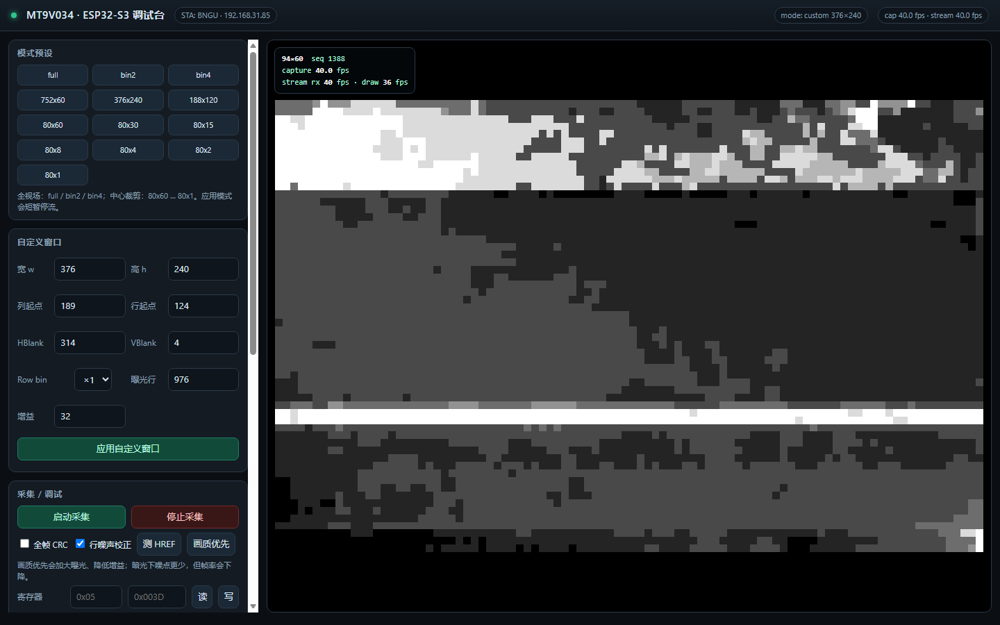
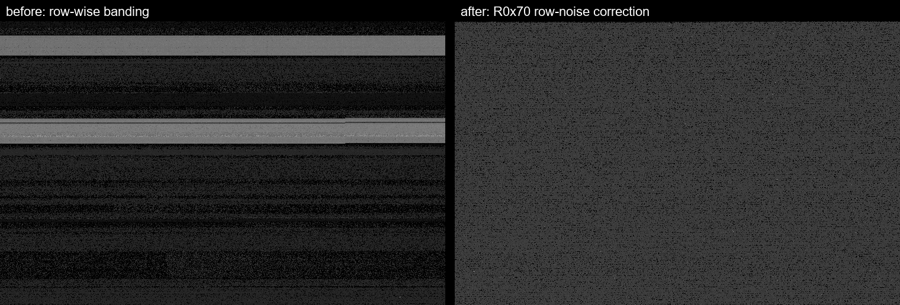
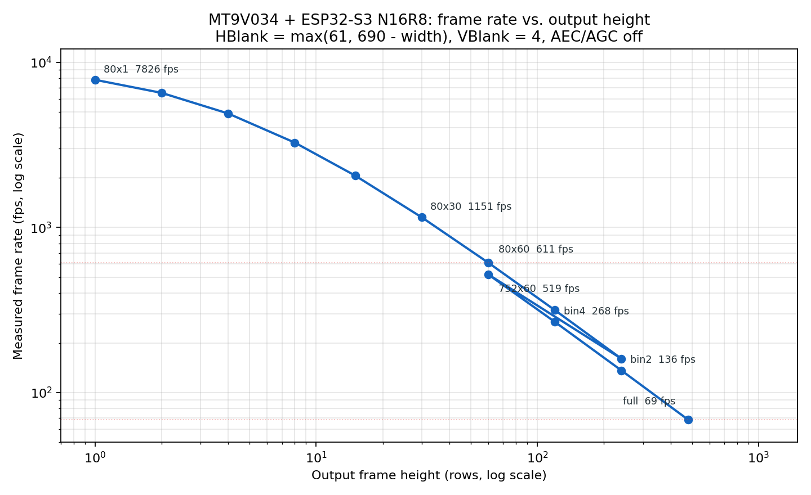

# Darts ESP32-S3 + MT9V034

ESP32-S3 N16R8 驱动逐飞「总钻风」MT9V034 全局快门摄像头的**实测固件与帧率测试结果**。

- MCU：ESP32-S3，16 MB Flash，8 MB Octal PSRAM
- SDK：ESP-IDF **v6.0.1**
- 采集：LCD_CAM DVP + GDMA，8-bit 灰度（GRAY8）
- 摄像头控制：**直接 I2C**，7-bit 地址 `0x5C`（本模块的 51 单片机已旁路，转接板 TXD/RXD 即 SCL/SDA）
- 结果：全分辨率 **68.6 fps**；80×60 **611.4 fps**；极限 80×1 **7826 fps**；长时间测试 0 丢帧
- Web 调试台：ESP32 **STA 连接 BNGU**（密码 `12345678`），浏览器打开 `http://<ESP32 IP>/` 实时控制 + 看画面



## Web 调试台（STA）

- 13 个模式预设、自定义窗口/消隐/曝光/增益/row bin、启动/停止、CRC、HREF 测量、寄存器读写、视频流参数、实时统计，全部在一个页面。
- **行噪声校正默认开启**：`R0x0D[7]` + `R0x70[0]`，每行先读 36 个光学黑列做逐行暗电平抵消，DVP stride=788 后裁掉黑列；修复短曝光/USB 供电下的横条纹，帧率不变。页面可勾选对比。
- **暗处噪点**：页面“降噪”默认做 3×3 空间 + 3 帧时间中值滤波，并把对比度增益限制在 8×；“画质优先”按钮用 4× 行时间的长曝光、gain=32 换信噪比（376×240 从 160 fps 降到 40 fps），暗处不再是满屏黑白点。
- 视频流与采集**解耦**：采集任务把降采样帧写进 3 个 slot；网络慢时只丢流帧（`stream_drop`），采集任务不等待 socket。实测全分辨率 68.6 fps、80×60 611.4 fps、80×1 7826 fps（目标 30）时采集 `drops=0`。
- 视频流默认 4-bit 自适应量化 + 自动对比度 + 目标 60 fps；可在页面切换 8-bit、1/2/4/8 降采样。
- 当前示例地址：`http://192.168.31.85/`（DHCP 可能变化，用 USB CLI `info` 查看）。

详细说明、WebSocket 协议、WiFi 限制与复现步骤见 [Web 调试台文档](docs/ESP32S3_MT9V034_Web调试台.md)。





## 实测结果

| 模式 | 输出 | 行 bin | 曝光行 | 实测 fps | DMA fps | 丢帧 |
|---|---|---:|---:|---:|---:|---:|
| full | 752×480 | ×1 | 400 | **68.616** | 68.333 | 0 |
| bin2 | 752×240 | ×2 | 200 | **136.107** | 136.333 | 0 |
| bin4 | 752×120 | ×4 | 100 | **267.822** | 268.001 | 0 |
| 752x60 | 752×60 | ×1 | 50 | **518.906** | 519.001 | 0 |
| 376x240 | 376×240 | ×1 | 200 | **160.369** | 160.334 | 0 |
| 188x120 | 188×120 | ×1 | 100 | **315.565** | 315.667 | 0 |
| 80x60 | 80×60 | ×1 | 50 | **611.407** | 611.334 | 0 |
| 80x30 | 80×30 | ×1 | 28 | **1150.883** | 1151.002 | 0 |
| 80x15 | 80×15 | ×1 | 15 | **2059.475** | 2059.337 | 0 |
| 80x8 | 80×8 | ×1 | 8 | **3260.838** | 3261.012 | 0 |
| 80x4 | 80×4 | ×1 | 4 | **4891.256** | 4891.080 | 0 |
| 80x2 | 80×2 | ×1 | 2 | **6521.697** | 6521.680 | 0 |
| 80x1 | 80×1 | ×1 | 2 | **7825.964** | 7826.023 | 0 |

- 60 s 连续运行：80×60 = 36,684 帧；80×1 = 469,560 帧；均 0 丢帧。
- 全帧 CRC 打开时仍能跟上 611 fps / 7826 fps，0 丢帧。
- 80×1 是「读出时序极限」，只有 1 行像素；可用的高速档建议用 **80×60 @ 611 fps**。

完整数据：[frame_rate_results.csv](docs/frame_rate_results.csv)、[longrun_results.csv](docs/longrun_results.csv)。

## 硬件接线

| 摄像头侧 | ESP32-S3 | 说明 |
|---|---|---|
| D0…D7 | GPIO11, 9, 8, 10, 12, 18, 17, 16 | 8-bit 数据总线 |
| VSY | GPIO6 | 帧有效 |
| HREF | GPIO7 | 行有效 / DE |
| PCLK | GPIO13 | 像素时钟 |
| TXD | GPIO44 | 本模块为 I2C **SCL** |
| RXD | GPIO43 | 本模块为 I2C **SDA** |
| 3V3 / GND | 3V3 / GND | 3.3 V 供电，必须共地 |

> 模块自带 27 MHz 时钟，不需要 ESP32 输出 XCLK；也没有单独的 RESET/PWDN 引出。
> 上电后传感器默认输出 752×480@60 fps；固件通过 I2C 改窗口、消隐、曝光和 row bin。

## 快速开始

```powershell
. 'C:\Espressif\tools\Microsoft.v6.0.1.PowerShell_profile.ps1'
cd D:\RoboMaster\Darts\Darts_ESP32S3_MT9V034
idf.py -B build set-target esp32s3
idf.py -B build build
idf.py -B build -p COM34 flash
```

若烧录后停在下载模式，用下面命令让应用重新运行：

```powershell
esptool --chip esp32s3 -p COM34 --after watchdog-reset read-mac
```

串口 CLI（USB-Serial/JTAG，115200）：

```text
probe                 # I2C 探测
mode read             # 读当前配置
mode full             # 752x480, HBlank=61, VBlank=4
mode bin2 / bin4      # 752x240 / 752x120
mode 80x60            # 80x60 中心裁剪
capstart              # 启动 DVP
bench 3               # 3 秒统计
capstop
dump                  # 输出一帧原始灰度
```

自动跑完 13 个模式并写 CSV：

```powershell
& 'D:\Program Files\Python313\python.exe' tools\run_matrix.py --port COM34 --seconds 3
```

抓一帧并保存 PNG：

```powershell
& 'D:\Program Files\Python313\python.exe' tools\dump_frame.py --port COM34 `
    --pre "mode 80x60" --pre "capstart" --out docs\images\frame.png
```

## 文档

- [Web 调试台说明](docs/ESP32S3_MT9V034_Web调试台.md) — STA 连接、页面控制、WebSocket 协议、解耦架构、WiFi 限制。
- [实测报告（推荐先看）](docs/ESP32S3_MT9V034_实测报告.md) — 接线、寄存器、帧时间模型、完整结果、复现步骤。
- [原始方案文档](docs/ESP32S3_MT9V034_帧率测试方案.md) — 早期的 UART/XCLK 方案与理论推导；其 UART、XCLK 假设不适用于本模块的实际 I2C 接法。
- [帧率原始数据](docs/frame_rate_results.csv)、[60 s 稳定性数据](docs/longrun_results.csv)

## 目录

```text
main/                固件
  main.c             CLI、启动流程
  web_server.c       STA / HTTP / WebSocket / stream 发送
  web/index.html      单文件 Web 调试台
  camera_control.c/h 模式/采集/流参数的应用层
  mt9v034_i2c.c/h    I2C 寄存器读写
  mt9v034_mode.c/h   窗口/消隐/曝光/row bin 预设
  mt9v_capture.c/h   LCD_CAM DVP + GDMA + 3 个 stream slot
tools/               主机脚本
  run_matrix.py      自动帧率矩阵
  dump_frame.py      抓帧存 PNG
  ws_probe.py        WebSocket 流测试
  web_cdp_test.py    无头 Edge/CDP 页面验证
  plot_results.py    生成帧率曲线
docs/                报告、CSV、图片
```
