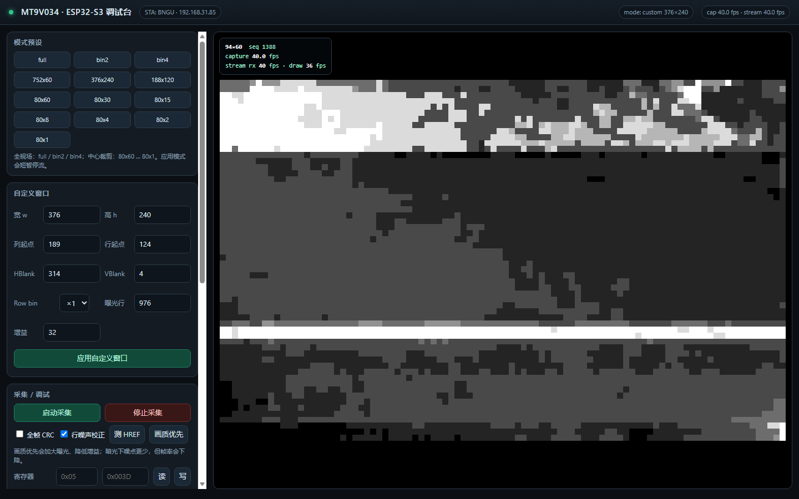
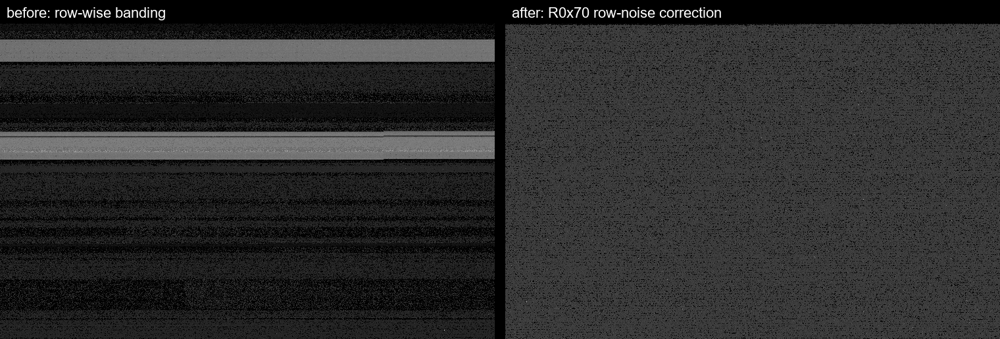

# ESP32-S3 + MT9V034 Web 调试台

| 项目 | 内容 |
|---|---|
| 日期 | 2026-11-06 |
| 开发板 | ESP32-S3 N16R8（16 MB Flash / 8 MB Octal PSRAM） |
| 摄像头 | 逐飞「总钻风」MT9V034，直接 I2C 模式（地址 0x5C） |
| 网络 | **STA 模式**连接 `BNGU`，密码 `12345678`；不是 SoftAP |
| 页面 | `http://<ESP32 从 BNGU 获得的 IP>/`，当前示例 `http://192.168.31.85/` |
| SDK | ESP-IDF v6.0.1 |



> 页面上的 `stream` 是网络发送帧率，`capture` 是传感器实际帧率。两者独立：网络慢时只丢视频流帧，不改变 DVP/传感器采集帧率。实测全分辨率 68.6 fps、80×60 611.4 fps、80×1 7826 fps 时，采集 `drops` 均为 0。

---

## 1. 功能

### 1.1 页面控制项

- **模式预设**：full、bin2、bin4、752x60、376x240、188x120、80x60、80x30、80x15、80x8、80x4、80x2、80x1。
- **自定义窗口**：宽、高、列起点、行起点、HBlank、VBlank、row bin、曝光行、模拟增益。
- **采集**：启动 / 停止；全帧 CRC 开关；HREF 频率测量；**行噪声校正开关（默认开）**。
- **寄存器**：任意 8-bit 寄存器地址读/写（16-bit 数据）。
- **视频流**：启用/关闭、降采样 1/2/4/8、4-bit/8-bit 像素、目标 fps、自动对比度。
- **实时统计**：采集 VSY、DMA、应用帧率、采集丢帧、流发送帧率、流丢弃、模式、RSSI、空闲堆、帧序号。
- **日志**：所有 WebSocket 命令与 ACK/错误。

### 1.2 实时画面

- 浏览器用 WebSocket 接收二进制帧，解析 16 字节头后画到 Canvas。
- 页面用 `requestAnimationFrame` 绘制最新帧，网络收到但来不及绘制的旧帧直接丢弃；不会阻塞发送端。
- **自动对比度**：短曝光画面可能只有 0–14 LSB，页面按当前帧 1%/99% 分位拉伸到 0–255，避免“全黑”。
- 4-bit 模式采用**自适应量化**：先把当前帧 min/max 映射到 0–15，再两像素/字节打包；比直接取高 4 位能保留暗场细节。

### 1.3 横条纹修复（行噪声校正）

页面最初看到的横条纹不是场景，而是 **MT9V034 的逐行偏置/暗电流噪声**：短曝光时信号很小，行与行之间的暗电平差被自动对比度放大，就变成横带。USB 供电的纹波会加重这一现象。

修复使用传感器自带的 **row-wise noise correction**：

- `R0x0D[7] = 1`：Show Dark Columns，每行先输出 36 个光学黑列；
- `R0x70[0] = 1`：用这 36 个黑列计算当前行的暗电平并从该行所有像素中减去，再叠加 `R0x71` 常数（默认 42）；
- 36 个黑列会让 DVP 行宽从 752 变成 **788**，固件按 stride=788 接收，再裁掉前 36 列；HBlank 同时被传感器缩短 36 个 PCLK，所以**帧率不变**；
- 默认开启，页面“行噪声校正”复选框可关掉做对比。

同一场景、同一曝光（HBlank=200、曝光 1000 行）的行均值标准差：

| 状态 | 行均值标准差 | 说明 |
|---|---:|---|
| 关闭 | 10.365 | 明显横带 |
| 开启 | 0.468 | 横带基本消失 |

全分辨率（HBlank=61、曝光 400）开启后行均值标准差 **0.147**。帧率实测完全不变：全分辨率 68.600 fps、80×60 611.405 fps、80×1 7826.028 fps，均为 0 丢帧。



> 图里镜头是盖住的/场景很暗，所以修复后是均匀噪声而不是清晰图像；去掉镜头盖、增加曝光后即可看到正常画面。行噪声校正只对**黑白** MT9V034 有效；彩色传感器不能使用该算法。

### 1.4 暗处黑白噪点与“画质优先”

高速预设为了帧率使用了**短曝光 + 高增益（gain=64）**。暗光下信号接近噪声底，像素噪声和列固定模式噪声（column FPN）被模拟增益放大；再经过 4-bit 自适应量化和自动对比度，就表现为暗处的黑白亮点/竖条。行噪声校正只能去除逐行偏置，不能去除像素/列噪声。

页面提供两个软件措施：

- **降噪**（默认开）：显示前先做 3×3 空间中值滤波，再做 3 帧时间中值滤波；空间滤波去固定坏点/列噪声，时间滤波去随机黑白点。绘制循环限制在 60 fps，避免高刷屏把 CPU 占满。
- **自动对比度上限 8×**：暗场不再被无限拉伸成纯黑白；配合降噪，暗处保持深灰而不是满屏亮点。
- **“画质优先”按钮**：按当前分辨率设置 `曝光 ≈ 4×(输出行数+4)`、`gain=32`，用更长积分换信噪比；帧率会下降。

376×240 的两种档位对比（行噪声校正开）：

| 档位 | 曝光行 | 增益 | 实测采集 | 画面 |
|---|---:|---:|---:|---|
| 高速预设 | 200 | 64 | 160 fps | 暗处有明显黑白点/列噪声 |
| 画质优先 | 976 | 32 | 40 fps | 暗处平滑，能看到真实场景 |

> 如果场景本身很暗，**更多光照**永远比后期拉伸更有效；在 160 fps 下要求完全无噪点是不现实的。需要高速时用预设；需要看清暗处时点“画质优先”。


---

## 2. 解耦架构

```text
MT9V034 ──DVP──> LCD_CAM/GDMA ──> 8 个 360960 B PSRAM 帧缓冲
                                      │
                                      ▼
                          capture task（core 1，优先级 8）
                          ├─ 更新 VSY/DMA/APP 统计
                          ├─ 可选 CRC / dump
                          └─ stream_publish()
                                │  ［3 个 stream slot，非阻塞］
                                ▼
                          stream slot 0/1/2
                                │  最新帧；槽满则丢流帧
                                ▼
                          web stream task（core 0）
                          ├─ 取最新 ready slot
                          ├─ 加 16 B 头
                          └─ WebSocket 发送
                                │
                                ▼
                          浏览器 Canvas
```

关键点：

1. **帧缓冲不交给网络任务**。采集任务只把降采样后的副本写进 3 个 stream slot；网络发送慢时，采集任务找不到空槽就 `stream_drop++`，立即返回，不等待 socket。
2. **采集任务固定在 core 1**，WiFi/HTTP/WebSocket 在 core 0；实测 80×1 的 7826 fps 下，页面以 60 fps 限制推流时采集 `drops=0`。
3. **流目标 fps 默认 60**。浏览器显示上限约 60 fps，把 7.8 kHz 传感器帧全部塞进网络没有意义；限流后采集端 stream_publish 开销也最小。
4. **降采样在采集任务内完成**，只读输出像素（如 94×60），不做 360 KB 全帧拷贝；全分辨率默认 1/8，输出 94×60。
5. **4-bit 自适应量化**把每帧字节数减半；8-bit 模式仍可在页面选择。
6. **TCP_NODELAY** 在 WebSocket 握手后设置，避免小帧被 Nagle/延迟 ACK 拖慢。

---

## 3. WiFi 连接

### 3.1 STA 配置

- `esp_netif_create_default_wifi_sta()`
- SSID `BNGU`，密码 `12345678`，WPA2-PSK
- 启动前扫描同 SSID 的 2.4 GHz BSSID，选择 RSSI 最好的一个并 `bssid_set` 固定
- 国家码 CN、`WIFI_PS_NONE`；`esp_wifi_set_bandwidth(WIFI_BW20)` 请求 20 MHz（实际以 AP 协商为准）
- 固定 11g 54 Mbps：本机 2.4 GHz 链路在自动速率下吞吐反而更低；固定 54M 后 ping/HTTP 更稳定
- 掉线自动重连

启动日志示例：

```text
web: AP 8c:de:f9:20:0f:66 ch=1 rssi=-33 auth=3
web: pinned BSSID 8c:de:f9:20:0f:66 rssi=-33
web: STA got IP 192.168.31.85
web: STA connected to BNGU, web UI at http://192.168.31.85/ (ps=0 bw=1 phy=4)
```

> IP 由 BNGU 的 DHCP 分配，可能变化。板子通过 USB 连着电脑时，在串口 CLI 执行 `info` 可看到当前 URL；也可以看路由器 DHCP 列表。

### 3.2 本机链路实测与限制

测试时电脑连的是 BNGU 的 **5 GHz**（BSSID `...:65`），ESP32 连的是同一路由器的 **2.4 GHz**（BSSID `...:66`）。跨频段转发下：

- RSSI：-30 ~ -44 dBm（信号很强）
- ping：10–190 ms 抖动，偶发 12–33% 丢包
- 原始 HTTP 1 MB：约 70–175 KB/s

因此页面 4-bit 80×60 流约 50–70 fps，94×60 流约 34 fps；这是**链路/路由器跨频段**的限制，不是采集或 ESP32 处理能力的限制。电脑改用 2.4 GHz 连接 BNGU 通常能明显改善。采集侧不受影响：

| 场景 | 采集 VSY | DMA | APP | 采集 drops | 流 |
|---|---:|---:|---:|---:|---:|
| 752×480，流 1/8 4-bit | 68.602 | 68.602 | 68.602 | 0 | ~34 fps |
| 80×60，流 1/1 4-bit | 611.401 | 611.401 | 611.401 | 0 | 50–70 fps |
| 80×1，流 1/1 4-bit，目标 30 | 7826.030 | 7826.030 | 7826.030 | 0 | 30 fps |

> 上表是在 WebSocket 页面保持连接、持续推流时用 USB CLI `bench` 测的；`bench` 会重置统计，所以 `drops=0` 是窗口内真实值。页面状态里的累计 drops 可能包含模式切换瞬间的几帧。80×1 把目标 fps 提到 60 时，5 s 内 VSY/DMA 仍是 7826，应用层有 3/39134（0.008%）帧未及时处理；目标 30 时为 0。

---

## 4. WebSocket 协议

### 4.1 文本命令

页面与固件之间用纯文本命令，便于调试：

```text
hello
status
presets
mode full | bin2 | ... | 80x1
apply <w> <h> <col> <row> <hblank> <vblank> <rowbin> <exp> <gain>
start
stop
crc on|off
rownoise on|off
stream on|off
stream div 1|2|4|8
stream pack 4|8
stream fps N
reg <addr_hex>
setreg <addr_hex> <value_hex>
href <ms>
```

服务端回复：

```json
{"type":"ack","ok":true,"cmd":"mode"}
{"type":"status","mode":"80x60","w":80,"h":60,"col":337,"row":214,"hb":610,"vb":4,"rb":0,"exp":50,"gain":64,"running":1,"crc":0,"rn":1,"vsy":611.4,...}
{"type":"presets","list":["full","bin2",...]}
{"type":"href","edges":478,"vsy":1,"fps":1000.0,"lines":478.0}
```

### 4.2 二进制帧

每个 WebSocket binary message：

| 偏移 | 类型 | 含义 |
|---:|---|---|
| 0–1 | `char[2]` | `'M','T'` |
| 2 | `uint8` | 版本，当前 1 |
| 3 | `uint8` | flags，bit0=1 表示 4-bit packed |
| 4–5 | `uint16 LE` | 输出宽 |
| 6–7 | `uint16 LE` | 输出高 |
| 8–11 | `uint32 LE` | 帧序号 |
| 12–15 | `uint32 LE` | 毫秒时间戳 |
| 16… | `uint8[]` | 像素：8-bit 为 w×h；4-bit 为 ceil(w×h/2) |

4-bit 时每字节高 nibble 是偶数像素，低 nibble 是奇数像素。

---

## 5. 复现

### 5.1 编译烧录

```powershell
. 'C:\Espressif\tools\Microsoft.v6.0.1.PowerShell_profile.ps1'
cd D:\RoboMaster\Darts\Darts_ESP32S3_MT9V034
idf.py -B build set-target esp32s3
idf.py -B build build
idf.py -B build -p COM34 flash
```

若停在下载模式：

```powershell
esptool --chip esp32s3 -p COM34 --after watchdog-reset read-mac
```

### 5.2 获取 IP

```powershell
python tools\serial_cli.py --port COM34 --cmd "info"
# WEB http://192.168.31.85/  STA=BNGU / 12345678
```

浏览器打开该 URL。手机/电脑需要与 ESP32 在同一个 BNGU 局域网内。

### 5.3 命令行验证页面/视频流

```powershell
# 通过 WebSocket 抓 6 秒 80x60 4-bit 流，统计 ws fps，存一帧 PNG
python tools\ws_probe.py --host 192.168.31.85 --seconds 6 --div 1 --pack 4 --mode 80x60

# 无头 Edge + CDP：加载页面、点 full、截图、读状态
python tools\web_cdp_test.py --url http://192.168.31.85/ --preset full --wait 8 `
    --screenshot docs\images\web_ui.png
```

`web_cdp_test.py` 需要先启动一个带调试端口的无头 Edge：

```powershell
msedge --headless=new --disable-gpu --remote-debugging-port=9222 `
    --user-data-dir="$env:TEMP\edge-cdp-mt9v" about:blank
```

---

## 6. 文件

```text
main/web_server.c        STA、HTTP、WebSocket、stream slot 发送、命令解析
main/web/index.html      单文件页面（HTML/CSS/JS）
main/mt9v_capture.c      DVP/GDMA、帧缓冲、stream_publish、4-bit 打包
main/camera_control.c    模式/启动/停止/流参数的应用层
main/mt9v034_mode.c      13 个预设（曝光已提高到不降低帧率的上限附近）
tools/ws_probe.py        WebSocket 流测试
tools/web_cdp_test.py    无头 Edge/CDP 页面验证
docs/images/web_ui.png   页面截图（full 752×480，1/8 4-bit，行噪声校正开启）
docs/images/row_noise_before_after.png  横条纹修复前后对比
```

---

## 7. 已知限制

1. **2.4 GHz 链路是瓶颈**：当前电脑走 5 GHz、ESP32 走 2.4 GHz，跨频段转发丢包/抖动明显；页面帧率受其限制。把客户端也连到 BNGU 2.4 GHz 可改善。
2. **4-bit 自适应量化**适合暗场/调试，不保留原始 8-bit 灰度；需要原始数据时在页面选 8-bit，或使用 `dump` 命令。
3. **固定 11g 54M** 是为当前弱链路做的取舍；换环境/距离变远时如连接不稳定，可改回自动速率（删除 `esp_wifi_config_80211_tx_rate` 与 `WIFI_PROTOCOL_11G` 两行）。
4. **IP 会变**：DHCP 重新分配后以 USB `info` 输出为准；没有实现 mDNS。
5. **页面只维护一个 WebSocket 客户端**：后连接的客户端会接管 `s_ws_fd`，适合单调试者。
6. 80×1 的 7826 fps 是读出时序极限，不是实用图像；高速可用档建议 80×60 @ 611 fps。
