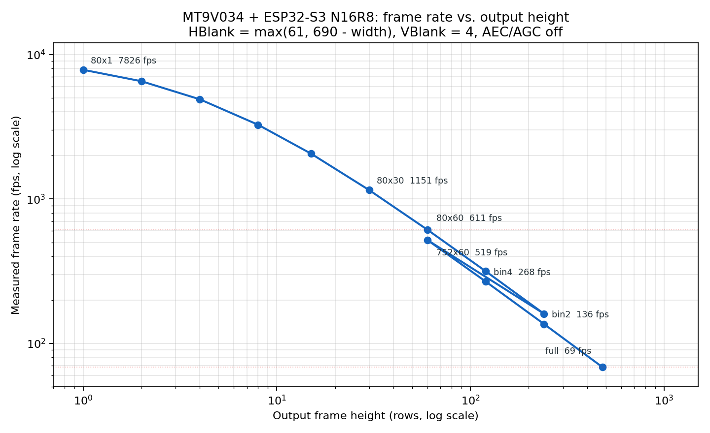
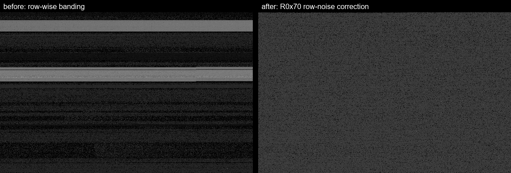

# ESP32-S3 N16R8 驱动 MT9V034：实测帧率报告

| 项目 | 内容 |
|---|---|
| 日期 | 2026-11-06 |
| 开发板 | ESP32-S3，16 MB Flash，8 MB Octal PSRAM（N16R8），USB-Serial/JTAG `COM34` |
| 摄像头 | 逐飞科技「总钻风」MT9V034 模块 + 转接板 |
| SDK | ESP-IDF v6.0.1（`C:\esp\v6.0.1\esp-idf`） |
| 采集接口 | LCD_CAM DVP + GDMA，8-bit 灰度，GRAY8 |
| 结论 | 全分辨率 **68.6 fps**；80×60 **611.4 fps**；极限 80×1 **7826 fps**；全部 0 丢帧 |



---

## 1. 结论摘要

1. **全分辨率 752×480 的规格内上限为 68.6 fps**。把 HBlank 从默认 94 压到最小值 61、VBlank 从 45 压到 4，同时关闭 AEC/AGC、把曝光设为 400 行（仍在 484 行帧预算内），实测 68.616 fps；DMA 与应用程序计数同为 68.333 fps，0 丢帧。
2. **80×60 实测 611.4 fps**，高于逐飞资料标称的「80×60 最高约 498 fps」。这是在 27 MHz PCLK、最小行时间 690 PCLK、VBlank=4 下得到的；输出的是 80×60 中心裁剪，不是 752×480 全视场。
3. **绝对极限为 80×1 的 7826 fps**。MT9V034 的最小帧时间是 5 行（1 行有效 + 4 行 VBlank），行时间最小 690 PCLK；继续提高只能减少行数，不能靠改消隐再快。把 VBlank 设成 2 实测仍是 7826 fps，说明传感器内部按 5 行钳位。
4. **链路没有成为瓶颈**：上表所有模式 `VSY ≈ DMA ≈ 应用`，0 drops；80×1 连续 60 s 共 469,560 帧、80×60 连续 60 s 共 36,684 帧，均 0 丢帧。全帧 CRC 打开时 80×60/80×1 也能跟上（见第 6 节）。
5. **本模块实际工作在直接 I2C 模式，不是 UART 模式**。板上 51 单片机被旁路，转接板的 TXD/RXD 分别变成 SCL/SDA；I2C 7-bit 地址为 **0x5C**，芯片版本寄存器 0x00 读出 **0x1324**。这是本次调试最关键的硬件发现，详见第 3 节。

### 1.1 推荐档位

| 场景 | 模式 | 实测帧率 | 说明 |
|---|---|---:|---|
| 全视场、最高分辨率 | 752×480 | 68.6 fps | 比赛/算法基线，视场最大 |
| 全视场、行 bin 2 | 752×240 | 136.1 fps | 垂直分辨率减半，视场不变 |
| 全视场、行 bin 4 | 752×120 | 267.8 fps | 垂直分辨率 1/4，视场不变 |
| 高帧率、可用图像 | 80×60 | 611.4 fps | 中心裁剪，适合小目标/高速触发 |
| 极限测试 | 80×1 | 7826 fps | 只有 1 行，不能当普通图像使用 |

---

## 2. 硬件连接

### 2.1 实际接线

| 摄像头侧 | ESP32-S3 | 方向（相对 S3） | 说明 |
|---|---|---|---|
| D0 | GPIO11 | 输入 | 8-bit 数据总线 bit0 |
| D1 | GPIO9 | 输入 | bit1 |
| D2 | GPIO8 | 输入 | bit2 |
| D3 | GPIO10 | 输入 | bit3 |
| D4 | GPIO12 | 输入 | bit4 |
| D5 | GPIO18 | 输入 | bit5 |
| D6 | GPIO17 | 输入 | bit6 |
| D7 | GPIO16 | 输入 | bit7 |
| VSY | GPIO6 | 输入 | 帧有效，上升沿计数 |
| HREF | GPIO7 | 输入 | 行有效 / DE |
| PCLK | GPIO13 | 输入 | 像素时钟，上升沿采样 |
| TXD | GPIO44 | 双向 | 本模块为 **I2C SCL** |
| RXD | GPIO43 | 双向 | 本模块为 **I2C SDA** |
| 3V3 | 3V3 | 电源 | 模块 3.3 V |
| GND | GND | 地 | 必须共地 |

> 用户描述中的「8 位地址总线」实际是 **8 位并行数据总线**；这里按 D0…D7 记录。转接板丝印的 D0…D7 对应模块的 8-bit 输出，D0 为最低位。

### 2.2 为什么没有 XCLK / RESET / PWDN

- 「总钻风」模块自带 27 MHz 时钟源，PCLK 实测约 **27.0 MHz**；ESP32-S3 不需要输出 XCLK。
- 模块的 51 单片机负责上电配置；本模块已被改成直接 I2C 模式，51 不再参与，因此也没有 UART 配置链路。
- 转接板只引出 PCLK、TXD、RXD、HREF、VSYNC、D0–D7、3V3、GND，没有单独的 RESET/PWDN 引脚。

### 2.3 I2C 模式的发现过程

最初按逐飞 UART 协议在 GPIO43/44 上以 9600…460800 bps、两种 TX/RX 方向扫描，摄像头都没有任何回包；但 VSY 一直有 61 fps 输出，说明传感器本身在工作。随后在 GPIO44=SCL、GPIO43=SDA 上做 I2C 扫描，发现：

- 7-bit 地址 **0x5C** 有 ACK；
- 读寄存器 0x00 返回 **0x1324**，正是 MT9V034 的 Chip Version；
- 读 0x01–0x06 得到 Column Start=1、Row Start=4、Height=480、Width=752、HBlank=94、VBlank=45，与 datasheet 默认值一致。

因此确认：**转接板 TXD/RXD 走的是传感器原生两线串行接口，51 单片机已被旁路，地址由 S_CTRL_ADR0/1 拉高决定为 0x5C（8-bit 写 0xB8 / 读 0xB9）**。后续所有配置都走这条 I2C。

---

## 3. 固件结构

```text
main/
  main.c             CLI、模式表、bench/dump 命令
  mt9v034_i2c.c/h    I2C 主机、8-bit 寄存器地址 + 16-bit 数据、重试
  mt9v034_mode.c/h   窗口/消隐/曝光/增益/row bin 预设与回读校验
  mt9v_capture.c/h   LCD_CAM DVP + GDMA、8 个 PSRAM 帧缓冲、VSY/HREF ISR
tools/
  run_matrix.py      自动跑完整帧率矩阵，输出 CSV
  dump_frame.py      抓一帧原始灰度图并存 PNG
  plot_results.py    生成帧率曲线
```

### 3.1 采集链路

- `esp_cam_ctlr_dvp`（ESP-IDF 6.0 的 `esp_driver_cam`）配置为 8-bit、`CAM_CTLR_COLOR_GRAY8`，输入/输出均为 GRAY8，`external_xtal = 1`、`xclk_io = GPIO_NUM_NC`。
- 数据脚：D0…D7 = 11, 9, 8, 10, 12, 18, 17, 16；VSY=6，DE/HREF=7，PCLK=13。
- GDMA 每帧一个 EOF；8 个 360,960 B 的 PSRAM 帧缓冲，单生产者/单消费者环形队列；回调只做索引交接，不做像素处理，保证高帧率下不丢帧。
- 统计三路计数：
  - **VSY**：GPIO6 上升沿中断，传感器实际帧率；
  - **DMA**：GDMA 完成中断；
  - **APP**：采集任务取走并归还缓冲的次数。
- `bench` 同时给出 `vsy_fps`、`dma_fps`、`app_fps`、`drops`，只有三者一致且 drops=0 才判为有效上限。

### 3.2 传感器寄存器配置

| 寄存器 | 作用 | 典型值 |
|---|---|---|
| 0xAF | AEC/AGC 使能 | 0（关闭，才能用 0x0B 手动曝光） |
| 0x01 / 0x02 | Column / Row Start | 全视场 1 / 4；80×60 裁剪 337 / 214 |
| 0x03 / 0x04 | Window Height / Width | 480 / 752；80×60 为 60 / 80 |
| 0x05 | Horizontal Blanking | 全宽 61；窄窗口按 `max(61, 690-width)` |
| 0x06 | Vertical Blanking | 4 |
| 0x0B | Coarse Shutter Width Total（曝光行数） | 100（全分辨率）；20（80×60） |
| 0x0D[1:0] | Row Bin | 0 / 1 / 2（×1 / ×2 / ×4） |
| 0x35 | Analog Gain | 32（2×） |

模式切换时先清 0x07 bit7（关闭并行输出），改完窗口/消隐后再打开；每次写都有 3 次重试和回读校验，避免高帧率下 I2C NACK 造成半配置状态。

### 3.3 帧时间模型（已用实测验证）

MT9V034 的行时间与帧时间：

```text
row_time   = (window_width + HBlank) / PCLK
frame_time = (height_out + VBlank) * row_time + 4 / PCLK
FPS        = 1 / frame_time
```

约束：

- 最小总行时间 **690 PCLK**；HBlank 最小 61，窄窗口必须补足到 690。
- VBlank 最小 4；实测设 2 也不会再快，传感器内部按 5 行钳位。
- 本模块 PCLK = **27.0 MHz**（实测反推），不是 26.667 MHz。

用 27.0 MHz 代入：

| 模式 | 行时间 | 帧时间 | 理论 FPS | 实测 FPS |
|---|---:|---:|---:|---:|
| 752×480 | 813 / 27M = 30.11 µs | 484 × 30.11 µs = 14.574 ms | 68.62 | **68.615** |
| 752×240（bin2） | 30.11 µs | 244 × 30.11 µs = 7.347 ms | 136.1 | **136.106** |
| 752×120（bin4） | 30.11 µs | 124 × 30.11 µs = 3.734 ms | 267.8 | **267.822** |
| 752×60 | 30.11 µs | 64 × 30.11 µs = 1.927 ms | 518.9 | **518.904** |
| 80×60 | 690 / 27M = 25.56 µs | 64 × 25.56 µs = 1.636 ms | 611.4 | **611.404** |
| 80×30 | 25.56 µs | 34 × 25.56 µs = 0.869 ms | 1150.9 | **1150.879** |
| 80×1 | 25.56 µs | 5 × 25.56 µs = 0.128 ms | 7818 | **7826.0** |

理论与实测的偏差 <0.2%，说明链路没有额外帧开销，瓶颈完全在传感器读出时序。

---

## 4. 实测帧率矩阵

测试条件：3 s 窗口，AEC/AGC 关闭，CRC 关闭，`HBlank = max(61, 690-width)`、`VBlank = 4`。原始数据见 [frame_rate_results.csv](frame_rate_results.csv)。

| 模式 | 输出 | 行 bin | 曝光行 | VSY fps | DMA fps | APP fps | drops |
|---|---|---:|---:|---:|---:|---:|---:|
| full | 752×480 | ×1 | 400 | 68.616 | 68.333 | 68.333 | 0 |
| bin2 | 752×240 | ×2 | 200 | 136.107 | 136.333 | 136.333 | 0 |
| bin4 | 752×120 | ×4 | 100 | 267.822 | 268.001 | 268.001 | 0 |
| 752x60 | 752×60 | ×1 | 50 | 518.906 | 519.001 | 519.001 | 0 |
| 376x240 | 376×240 | ×1 | 200 | 160.369 | 160.334 | 160.334 | 0 |
| 188x120 | 188×120 | ×1 | 100 | 315.565 | 315.667 | 315.667 | 0 |
| 80x60 | 80×60 | ×1 | 50 | 611.407 | 611.334 | 611.334 | 0 |
| 80x30 | 80×30 | ×1 | 28 | 1150.883 | 1151.002 | 1151.002 | 0 |
| 80x15 | 80×15 | ×1 | 15 | 2059.475 | 2059.337 | 2059.337 | 0 |
| 80x8 | 80×8 | ×1 | 8 | 3260.838 | 3261.012 | 3261.012 | 0 |
| 80x4 | 80×4 | ×1 | 4 | 4891.256 | 4891.080 | 4891.080 | 0 |
| 80x2 | 80×2 | ×1 | 2 | 6521.697 | 6521.680 | 6521.680 | 0 |
| 80x1 | 80×1 | ×1 | 2 | 7825.964 | 7826.023 | 7826.023 | 0 |

> `376×240` 与 `188×120` 是**中心裁剪**，不是逐飞资料里的全视场 binning 模式。裁剪后行时间可以保持 690 PCLK，因此比全视场 752×240（136 fps）/752×120（268 fps）更快；代价是视场变小。

---

## 5. 长时间稳定性

60 s 连续运行，原始数据见 [longrun_results.csv](longrun_results.csv)。

| 模式 | 时间 | VSY fps | DMA 帧数 | APP 帧数 | drops |
|---|---:|---:|---:|---:|---:|
| 80×60 | 60 s | 611.405 | 36,684 | 36,684 | 0 |
| 80×1 | 60 s | 7825.964 | 469,560 | 469,560 | 0 |

80×1 在 60 s 内累计 **46.96 万帧**，VSY、DMA、应用计数完全一致，说明 DVP/GDMA/PSRAM 链路在 7.8 kHz 帧率下仍没有丢帧。

---

## 6. 数据完整性

### 6.1 全帧 CRC

| 模式 | 时间 | 处理帧数 | CRC 帧数 | CRC 变化帧 | drops |
|---|---:|---:|---:|---:|---:|
| 80×60 | 3 s | 1834 | 1834 | 1833 | 0 |
| 80×1 | 3 s | 23,478 | 23,478 | 23,477 | 0 |

CRC 对**每一帧的全部有效像素**计算（80×60 为 4800 B，80×1 为 80 B）；CRC 打开后仍能跟上 611 fps / 7826 fps，0 丢帧。CRC 逐帧变化说明读到的是实时变化的传感器数据，不是固定缓冲/全零数据。

### 6.2 图像抓取

固件 `dump` 命令通过 USB Serial/JTAG 把一帧原始 8-bit 灰度数据发到主机，`tools/dump_frame.py` 保存 PNG：

- [frame_full_longexp.png](images/frame_full_longexp.png)：752×480，长曝光（1000 行），可见真实场景，证明数据位序、HREF/VSY/PCLK 时序正确。
- [frame_full_752x480.png](images/frame_full_752x480.png)：752×480，100 行短曝光（全分辨率 68.6 fps 档），图像偏暗。
- [frame_80x60_maxfps.png](images/frame_80x60_maxfps.png)：80×60，20 行曝光（611 fps 档），均值 2.8、最大 14，主要是暗场噪声。
- [frame_80x60_longexp.png](images/frame_80x60_longexp.png)：80×60，长曝光，中心裁剪区域过曝为均匀亮区。

> 最大帧率档的曝光只有 2–20 行，室内光下图像必然很暗；这是「帧率优先」的取舍，不是链路错误。需要可用图像时，把 0x0B 曝光行数加大，帧率会按第 3.3 节公式下降。

---

## 7. 复现步骤

### 7.1 编译与烧录

```powershell
. 'C:\Espressif\tools\Microsoft.v6.0.1.PowerShell_profile.ps1'
cd D:\RoboMaster\Darts\Darts_ESP32S3_MT9V034
idf.py -B build set-target esp32s3
idf.py -B build build
idf.py -B build -p COM34 flash
```

> 本板的 USB-Serial/JTAG 在 esptool 的 `--after hard-reset` 下可能进入下载模式；必要时用
> `esptool --chip esp32s3 -p COM34 --after watchdog-reset read-mac` 让应用重新运行。

### 7.2 串口 CLI

```text
probe                 # I2C 探测，读 chip version
mode read             # 读当前窗口/消隐/曝光/增益
mode full             # 752x480, HBlank=61, VBlank=4
mode bin2 / bin4      # 752x240 / 752x120 全视场行 bin
mode 80x60            # 80x60 中心裁剪
mode 80x1             # 极限 80x1
capstart              # 按当前模式启动 DVP
bench 3               # 3 秒统计，打印 RESULT
capstop
dump                  # 输出一帧原始数据
```

### 7.3 自动测试

```powershell
& 'D:\Program Files\Python313\python.exe' tools\run_matrix.py --port COM34 --seconds 3
& 'D:\Program Files\Python313\python.exe' tools\dump_frame.py --port COM34 `
    --pre "mode 80x60" --pre "capstart" --out docs\images\frame.png
```

`run_matrix.py` 会一次性跑完 13 个模式并写 `docs/frame_rate_results.csv`。打开串口会复位开发板，因此必须像脚本这样在**同一个串口会话**里完成模式设置、采集和统计。

---

## 8. 讨论与限制

1. **没有超频**：模块自带 27 MHz 晶振，ESP32-S3 不输出 XCLK；本次没有把 PCLK 推到 40 MHz，也没有违反 datasheet 的 690 PCLK 最小行时间。所有帧率都在 MT9V034 规格时序内取得。
2. **80×1 不是实用图像**：它只有 1 行有效像素，7826 fps 是读出时序的极限值；对外汇报时应同时给出 80×60 的 611 fps 和全分辨率的 68.6 fps。
3. **短曝光与图像质量**：最大帧率档的曝光只有几行，室内光下图像很暗；如果提高曝光，帧时间会被积分时间拉长，帧率下降。这是全局快门传感器的正常取舍。
4. **UART 路径不可用**：本模块的 51 单片机已旁路，逐飞 UART 协议（0xA5 命令）不会响应。若换回 UART 版模块，需要恢复 `mt9v03x_uart` 驱动并把 GPIO43/44 切回 UART。
5. **I2C 写时序**：高帧率下传感器 I2C 偶发 NACK；固件通过关闭并行输出、3 次重试和回读校验解决。模式切换会短暂停流，属于预期行为。
6. **测量口径**：`vsy_fps` 是 3 s 总计数/时间，`vsy_ring` 是最近 1000 个 VSY 间隔的倒数，后者更精确；两者差异 <0.2%。判定上限时以三者一致且 drops=0 为准。

---

## 9. 参考

- MT9V034 datasheet（Rev. A），逐飞资料包内 `芯片手册/MT9V034-数据手册.PDF`。
- 逐飞「总钻风」使用说明 V2.7、转接板 V3.1 原理图。
- ESP-IDF v6.0.1 `esp_driver_cam` / `esp_cam_ctlr_dvp`。
- 本仓库原始方案文档：[ESP32S3_MT9V034_帧率测试方案.md](ESP32S3_MT9V034_帧率测试方案.md)（背景与理论推导；其中 UART/XCLK 假设不适用于本模块的实际 I2C 接法）。

---

## 10. Web 调试台（STA）

在以上采集/帧率固件之上增加了 Web 调试台，ESP32-S3 以 **STA 模式连接 BNGU**（不是 SoftAP），浏览器访问 DHCP 分配的地址即可。

- 13 个模式预设、自定义窗口/消隐/曝光/增益/row bin、启动/停止、CRC、HREF 测量、寄存器读写、视频流参数、实时统计都在一个页面里。
- 横条纹修复：开启 MT9V034 的 `R0x0D[7]`（Show Dark Columns）和 `R0x70[0]`（row noise correction），每行用 36 个光学黑列抵消逐行暗电平；DVP stride 变为 788，裁掉黑列后输出仍是 752×480。行均值标准差从 10.365 降到 0.468（HBlank=200/曝光 1000），帧率不变。
- 暗处噪点：高速预设的 gain=64 + 短曝光会把像素/列噪声放大成黑白点；页面“降噪”做 3×3 空间 + 3 帧时间中值滤波并把对比度增益限制在 8×，“画质优先”按钮用长曝光、gain=32 换信噪比（376×240 约 40 fps）。
- 视频流与采集解耦：采集任务只把降采样帧写入 3 个 stream slot；网络慢时丢流帧，采集任务不等待 socket。
- 页面默认 4-bit 自适应量化 + 自动对比度 + 目标 60 fps；可切换 8-bit 和 1/2/4/8 降采样。
- 推流时实测：全分辨率 68.602 fps、80×60 611.401 fps 均 0 丢帧；80×1 在目标 30 fps 时 7826.03 fps、0 丢帧（目标 60 时应用层 3/39134 未及时处理，VSY/DMA 仍为 7826）。

页面截图与控制项说明见 [ESP32S3_MT9V034_Web调试台.md](ESP32S3_MT9V034_Web调试台.md)。

