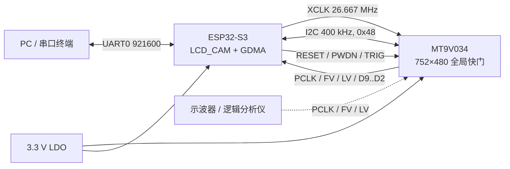
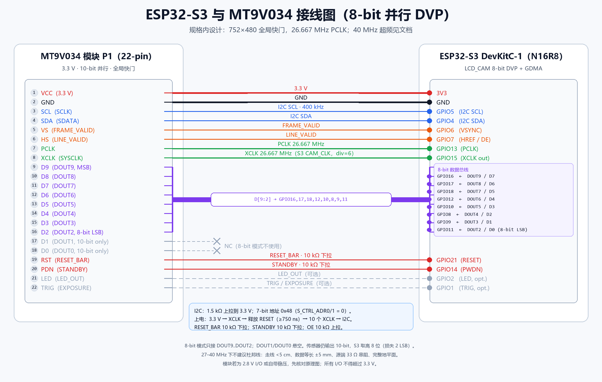
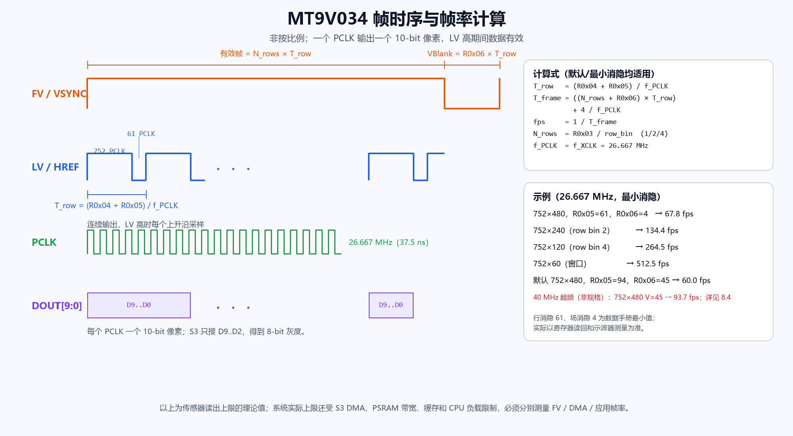

# ESP32-S3 驱动 MT9V034：引脚连接与帧率上限测试方案

> **2026-11-06 更新**：本次实测的「总钻风」模块处于**直接 I2C 模式**（7-bit 地址 0x5C，51 单片机旁路，TXD/RXD 即 SCL/SDA），且模块自带 27 MHz 时钟、不需要 S3 输出 XCLK。本文的 UART/XCLK 接线属于早期设计分析，不等于本次实际接线；实测数据、寄存器配置与结论见 [ESP32S3_MT9V034_实测报告.md](ESP32S3_MT9V034_实测报告.md)。

| 项目 | 内容 |
|---|---|
| 版本 | v1.0 |
| 日期 | 2026-11-05 |
| 适用硬件 | ESP32-S3-DevKitC-1（推荐 N16R8，Octal PSRAM）+ MT9V034 模块或裸片 |
| 采集方式 | 8-bit 并行 DVP，灰度，LCD_CAM + GDMA |
| 固件基线 | ESP-IDF 5.x，C 语言 |
| 文档目标 | 给出可复现的接线、寄存器配置、帧率测试矩阵与判定标准 |

> 本文的 fps 数值均为**理论读出上限**或**目标值**，最终结论必须以第 7 章的实测数据为准。MT9V034 的 60 fps 是默认模式，不是全分辨率下的绝对上限；另一方面，ESP32-S3 的 DMA、PSRAM 和缓存也可能先于传感器成为瓶颈。

---

## 0. 结论摘要

1. **推荐接线**：MT9V034 的 `DOUT9..DOUT2` 接 ESP32-S3 的 8 位 DVP 数据口；`DOUT1/DOUT0` 悬空。XCLK 由 S3 的 `CAM_CLK` 输出 26.667 MHz，I2C 7-bit 地址为 `0x48`；按 3.3 V 模块/裸片设计，不需要电平转换（2.8 V I/O 模块另查）。
2. **传感器全分辨率上限（分两档）**：按数据手册 26.667 MHz，默认约 60 fps，最小消隐（HBlank=61、VBlank=4）理论约 **67.8 fps**；第三方商用相机把 MT9V034 超频到 **40 MHz** 后，752×480 实测约 **93.7 fps**（VBlank=45），把 VBlank 压到 4 的理论值约 **101.6 fps**。40 MHz 超出数据手册的 27 MHz 规格，只作为实验室探索，不作为量产保证。
3. **提高帧率的正确手段**：**行 binning** 或**减小窗口高度**。26.667 MHz 下，行 bin 2 理论约 **134.4 fps**（752×240），行 bin 4 约 **264.5 fps**（752×120）；40 MHz 超频下分别约 **201.6 fps** 和 **396.8 fps**。列 binning 会降低 PCLK，不会提高帧率，不要用它做提速。
4. **系统上限必须分开测**：至少记录三个计数——传感器 FV 帧率、DMA 完成帧率、应用层帧率。只有三者一致且 CRC 无错，才能把该帧率判为“系统稳定上限”。
5. **最容易踩的坑**：
   - MT9V034 并行口是 **10-bit**，S3 的 DVP 是 8/16-bit；8-bit 接法必须接 `DOUT9..DOUT2`，接 `DOUT0..DOUT7` 会得到低 8 位而不是高 8 位。
   - 按 esp32-camera 的 S3 LL 实现，XCLK 是整数分频：配置值写 27 MHz 可能得到 32 MHz（超传感器规格上限）。用 26 MHz 配置值得到 26.667 MHz，并用示波器确认。
   - 22-pin 模块排线通常只有 1 根地线，27 MHz 下信号完整性风险很高；能打板就优先打板。
   - 行/场消隐低于最小值可能“看起来有图”，但会出现行错位、CRC 错误或偶发丢帧，必须用 CRC 和行计数验证。

**工程建议**：比赛/量产基线用 26.667 MHz 的规格内方案；40 MHz 只在实验室做“上限探索”，通过长期温度/电压/CRC 验证前不要写进正式固件。

---

## 1. 目标、范围与假设

### 1.1 目标

- 设计一套 ESP32-S3 与 MT9V034 的可靠引脚连接，覆盖电源、时钟、复位、I2C、8-bit DVP 和可选触发/曝光指示。
- 给出一套可复现的帧率上限测试方法，能够回答：
  - MT9V034 在全分辨率、最小消隐下的实际最大帧率是多少？
  - 行 bin 2/4、窗口裁剪能把帧率提高到多少？
  - 在哪个帧率下瓶颈从传感器转移到 ESP32-S3（DMA/PSRAM/CPU）？
  - 该帧率能否长期稳定、无丢帧、无数据错误？
- 输出测试记录模板和判定标准，便于不同板子/镜头/固件之间对比。

### 1.2 范围

**包含**：

- 单颗 MT9V034，单色（mono）或彩色（Bayer）均可，本文以灰度 8-bit 采集为主。
- 并行 DVP 输出；不使用 LVDS、不使用 stereo 主从模式。
- 室温、实验室供电、无 Wi-Fi/BT 干扰的基准测试。
- 传感器寄存器配置、S3 采集链路、帧率/完整性测量。

**不包含**：

- 镜头选型、光学标定、图像质量调优（gamma、去噪、坏点校正）。
- 量产一致性、EMC/ESD 认证、高低温循环。
- RoboMaster 视觉算法的精度/延迟评估；本文只提供帧率与数据完整性基线。

### 1.3 假设

- 使用 3.3 V 供电的 MT9V034 模块，或按第 4 章自行设计的裸片板。
- 使用 ESP32-S3 的 LCD_CAM 外设，8-bit DVP，GDMA 搬运。
- 帧缓冲区可以放在 PSRAM；推荐 N16R8（8 MB Octal PSRAM）。
- 测试时关闭 Wi-Fi/BT、SD 卡写入、屏幕刷新等占用 PSRAM/CPU 的功能。
- 逻辑分析仪/示波器带宽 ≥100 MHz，能测 26.667/40 MHz 的 PCLK 和 ns 级边沿。

---

## 2. 关键参数与设计约束

### 2.1 MT9V034 关键参数

| 参数 | 数值 | 对设计的影响 |
|---|---|---|
| 有效阵列 | 752 H × 480 V，6.0 µm 像素 | 全帧 360,960 像素 |
| 快门 | 全局快门 | 适合高速运动目标，无卷帘 skew |
| ADC / 并行输出 | 10-bit column-parallel，10-bit 并行 | S3 不能原生 10-bit 并行采集，需截位或 16-bit 打包 |
| 最大数据率 | 27 Mp/s（数据手册规格） | 规格内 PCLK ≤27 MHz；40 MHz 属于超频，见 4.2 方案 C |
| 主时钟 | 13–27 MHz，推荐 26.66 MHz | 规格内用 26.667 MHz；40 MHz 仅实验室超频 |
| 默认帧率 | 60 fps @ 752×480 | 默认消隐下的值；最小消隐约 67.8 fps，40 MHz 超频约 93.7 fps |
| 供电 | 3.3 V ±0.3 V（所有电源） | 与 S3 I/O 兼容，无需电平转换 |
| 功耗 | <160 mW @ 最大数据率（LVDS 关） | 约 50 mA @ 3.3 V，LDO 留 300 mA 余量 |
| 行消隐最小值 | 61 PCLK（normal） | 全分辨率行时间最小 752+61=813 PCLK |
| 场消隐最小值 | 4 行 | 低于 4 行不建议使用 |
| 行 bin | 2× / 4×，帧率约 2× / 4× | 提高帧率的首选手段 |
| 列 bin | 2× / 4×，PCLK 降为 1/2、1/4 | 不提高帧率，反而降低数据率 |
| I2C | 400 kHz，16-bit 寄存器，1.5 kΩ 上拉 | 地址由 ADR0/ADR1 决定，默认 0x48 |

数据来源：onsemi MT9V034 数据手册（Rev.9，2026-07），见第 10 章参考文献。

> **关于 40 MHz 超频**：MT9V034 数据手册的 SYSCLK 上限是 27 MHz，但 Balluff mvBlueFOX-200w 的 MT9V034 相机在 40 MHz 像素时钟下实测 752×480 @ 93.7 fps（HBlank=61、VBlank=45）。这说明芯片在实验室条件下有一定超频余量，但**超频不在 onsemi 规格内**，温度、电压、批次和信号完整性都会影响稳定性。本文把它作为可选的“探索上限”测试，不进入量产基线。

### 2.2 ESP32-S3 关键约束

| 项目 | 约束/事实 | 设计含义 |
|---|---|---|
| 摄像头接口 | LCD_CAM，8–16-bit DVP，PCLK 最高 40 MHz | 26.667 MHz 在能力范围内；40 MHz 是接口上限，超频时信号完整性风险最高 |
| 数据位宽 | 8-bit 或 16-bit，没有 10-bit 模式 | 8-bit 截位，或 16-bit 打包后软件移位 |
| DMA | GDMA，AHB，支持 PSRAM | 每帧一个 EOF，双缓冲/多缓冲 |
| 内部 SRAM | 512 KB | 全分辨率双缓冲放不下，必须 PSRAM |
| PSRAM | N16R8 为 Octal 80 MHz | 全分辨率 24.5 MB/s 写入可承受；四线 PSRAM 余量较小 |
| GPIO 限制 | 26–32 Flash，33–37 Octal PSRAM，47/48 SPI 时钟 | 这些脚不能用于摄像头 |
| 启动/调试 | 0/3/45/46 为 strapping；19/20 USB；39–42 JTAG；43/44 UART0 | 本文映射全部避开 |
| 上电毛刺 | GPIO1–14 在复位时有约 60 µs 低电平毛刺 | 传感器保持复位，毛刺不影响；RESET 放在 GPIO21 |

### 2.3 为什么用 8-bit，而不是 10-bit/16-bit

MT9V034 的并行口只有 10-bit，ESP32-S3 的 DVP 只支持 8-bit 或 16-bit：

- **8-bit 方案（推荐）**：接 `DOUT9..DOUT2`，丢弃最低 2 位。每像素 1 字节，全帧 360,960 B；60 fps 时 21.7 MB/s，67.8 fps 时 24.5 MB/s。DMA 和 PSRAM 压力最小，适合帧率上限测试。
- **16-bit 方案（保留 10-bit）**：把 `DOUT9..DOUT0` 接到 D0–D9，配置 16-bit DVP。每像素 2 字节，全帧 721,920 B；同样 67.8 fps 时写入约 48.9 MB/s，再加 CPU 读取/CRC 很容易超过 PSRAM 有效带宽。除非项目明确需要 10-bit 灰度，否则不建议用这个方案做“最高帧率”。
- **8-bit 截位的代价**：损失 2 LSB，约 0.2% 满量程；对帧率、同步、目标检测没有本质影响。对低照度量化要求很高的场景，再考虑 10-bit 方案。
- **40 MHz 超频时更不要用 16-bit**：全分辨率 101.6 fps 的 16-bit 写入约 73 MB/s，基本超过 S3 的可持续 PSRAM 带宽；超频测试只建议 8-bit。

> 重要：模块资料可能把 `D2` 标成“8-bit LSB”。这是**板级 8-bit 接法**的含义，不是传感器内部有 8-bit 并行模式。传感器仍然输出 10-bit，`D2` 只是被截取后的最低位。

---

## 3. 系统框图



数据通路：

```text
MT9V034 → 8-bit DVP → ESP32-S3 LCD_CAM → GDMA → 帧缓冲（SRAM/PSRAM）
       → 帧统计（FV/DMA/应用计数、CRC、行数） → UART 上报
```

---

## 4. 硬件设计

### 4.1 供电与去耦

- **电压**：MT9V034 的 VDD、VAA、VAAPIX、VDDLVDS 全部为 3.3 V ±0.3 V；不要给 I/O 加 5 V。
- **电流**：传感器最大约 160 mW（约 50 mA），加 S3 和 USB-UART，整板建议 5 V/1 A 输入，3.3 V LDO 至少 300 mA。
- **LDO 选择**：TPS7A2033、AP2112K-3.3、RT9013-33 等；如果传感器和 S3 共用一路 LDO，建议在传感器前加磁珠 + 10 µF + 1 µF + 0.1 µF。
- **去耦**：每个电源脚就近 0.1 µF；每路电源入口 10 µF + 1 µF。模拟/像素电源（VAA、VAAPIX）与数字电源分开走线，最后在 LDO 地处单点汇合。
- **地**：完整地平面；传感器 AGND/DGND 在器件下方连接，不要在地平面上开长槽。模块通常只有 1 根地线，尽量在转接板上增加地针。
- **模块供电**：如果模块自带 3.3 V 稳压器，按模块说明给它 5 V 或 3.3 V，**不要把 3.3 V 直接灌到稳压器输出端**。如果模块是 2.8 V I/O，必须确认 S3 的 3.3 V 输出不会过压。
- **上电顺序**：3.3 V 稳定 → XCLK 运行 → 释放 RESET → 等 10 个 XCLK → I2C。RESET 释放前不要让数据线驱动传感器。**不要带电插拔摄像头排线。**

### 4.2 时钟方案

#### 方案 A：S3 产生 26.667 MHz XCLK（规格内，推荐）

ESP32-S3 的 LCD_CAM 可以把内部 160 MHz 时钟分频后从 `CAM_CLK` 输出，官方 S3 摄像头 LL 层就是这样做：

```c
// 目标：26.667 MHz = 160 MHz / 6
// 配置值写 26 MHz，整数分频得到 6，实际输出 26.667 MHz
config.xclk_freq_hz = 26000000;
```

注意：

- **不要写 27 MHz**。`160 MHz / 27 MHz = 5.93`，整数分频会得到 5，实际 XCLK = 32 MHz，超过 MT9V034 数据手册的 27 MHz 规格上限。
- 26 MHz 配置值 → 分频 6 → 26.667 MHz；25 MHz 也会得到 6。以实测为准。驱动内部若用 `xclk_freq_hz` 反算曝光/帧率，注意实际值是 26.667 MHz，不是 26.000 MHz。
- XCLK 占空比要求 45%–55%，上升/下降时间 <5 ns。S3 的分频输出理论上为 50%，但必须用示波器在传感器 XCLK 脚确认。
- XCLK 走线串 33 Ω（靠近 S3 端），尽量短，远离 PCLK/数据线。
- **如果模块自带 27 MHz 晶振/时钟源，不要再由 S3 驱动 XCLK**；先看模块原理图，确认 XCLK 是输入还是已有输出。

#### 方案 B：外部 27 MHz 有源晶振（备选）

如果 S3 的 XCLK 占空比、抖动或电平不满足要求，改用 27.000 MHz 有源晶振：

- 输出接传感器 XCLK；晶振电源加 0.1 µF + 1 µF。
- 27 MHz 下全分辨率最小消隐理论约 68.6 fps，比 26.667 MHz 高约 1.25%。
- 晶振输出如果是 1.8 V/2.5 V，必须确认传感器 VIH；MT9V034 的 VIH 约为 VDD−1.4 V = 1.9 V，2.5 V 可以，1.8 V 不够。
- 外部晶振不会占用 S3 的 GPIO15，可把 GPIO15 释放出来。

#### 方案 C：40 MHz 超频（仅实验室，可选）

如果项目愿意承担超频风险，可以把 XCLK/PCLK 推到 ESP32-S3 摄像头接口的上限 40 MHz：

- S3 分频 4：`160 MHz / 4 = 40.000 MHz`，占空比 50%。
- MT9V034 数据手册标注 SYSCLK 最大 27 MHz；40 MHz 超出规格，onsemi 不保证。Balluff 商用相机有 40 MHz 实测 93.7 fps 的公开数据，可作为“可尝试”的依据，不是保证。
- 配置：`config.xclk_freq_hz = 40000000;`，S3 分频 4，实际 40.000 MHz。
- 40 MHz 下 PCLK 周期 25 ns，S3 的 8-bit DVP 已到接口上限，GPIO matrix/排线/PCB 的时序余量非常小。必须用短走线、完整地平面和 22–33 Ω 串阻，并用 CRC 验证。
- 模块上的电平转换、串阻或排线可能先限制 40 MHz；裸片/自定义板通常比现成模块更容易成功。
- 如果模块自带固定 27 MHz 晶振，40 MHz 超频需要改板/换晶振，不能直接靠 S3 的 XCLK 覆盖。
- 超频会增加功耗和发热，可能缩短器件寿命。先测 26.667 MHz 基线，再逐步升到 40 MHz；如果 CRC 或温度异常，立即回到 26.667 MHz。
- 不要把 40 MHz 写进量产固件，除非完成温度、电压、批次和长期稳定性验证。

> PCLK 始终由 MT9V034 输出，S3 只接收。不要试图用 S3 去“驱动”PCLK。

### 4.3 引脚连接

#### 4.3.1 与 22-pin MT9V034 模块的对应关系

下表按常见 ArduCAM/MT9V034 模块的 P1 定义编排。**接线前先用万用表和模块原理图核对 pin 1 方向**。

| 模块 Pin | 信号 | ESP32-S3 GPIO | 方向（相对 S3） | 说明 |
|---:|---|---|---|---|
| 1 | VCC | 3V3 | 电源 | 3.3 V；不要接 5 V |
| 2 | GND | GND | 地 | 模块通常只有这一根地；建议在转接板上增加地针 |
| 3 | SCL / SCLK | GPIO5 | 输出 | I2C 时钟，1.5 kΩ 上拉 |
| 4 | SDA / SDATA | GPIO4 | 双向 | I2C 数据，1.5 kΩ 上拉 |
| 5 | VS / FRAME_VALID | GPIO6 | 输入 | 帧有效，高有效 |
| 6 | HS / LINE_VALID | GPIO7 | 输入 | 行有效/DE，高有效 |
| 7 | PCLK | GPIO13 | 输入 | 26.667 MHz，上升沿数据有效 |
| 8 | XCLK / SYSCLK | GPIO15 | 输出 | S3 CAM_CLK，26.667 MHz |
| 9 | D9 / DOUT9 | GPIO16 | 输入 | 8-bit 数据最高位 D7 |
| 10 | D8 / DOUT8 | GPIO17 | 输入 | D6 |
| 11 | D7 / DOUT7 | GPIO18 | 输入 | D5 |
| 12 | D6 / DOUT6 | GPIO12 | 输入 | D4 |
| 13 | D5 / DOUT5 | GPIO10 | 输入 | D3 |
| 14 | D4 / DOUT4 | GPIO8 | 输入 | D2 |
| 15 | D3 / DOUT3 | GPIO9 | 输入 | D1 |
| 16 | D2 / DOUT2 | GPIO11 | 输入 | D0，8-bit 最低位 |
| 17 | D1 / DOUT1 | NC | — | 10-bit 才有用；8-bit 悬空 |
| 18 | D0 / DOUT0 | NC | — | 10-bit 才有用；8-bit 悬空 |
| 19 | RST / RESET_BAR | GPIO21 | 输出 | 低有效；10 kΩ 下拉 |
| 20 | PDN / STANDBY | GPIO14 | 输出 | 高有效；10 kΩ 下拉 |
| 21 | LED / LED_OUT | GPIO2（可选） | 输入 | 传感器输出曝光指示，S3 只读，可不接 |
| 22 | TRIG / EXPOSURE | GPIO1（可选） | 输出 | 快照触发，可不接 |

**数据位序**：`DOUT9 → GPIO16`，`DOUT8 → GPIO17`，……，`DOUT2 → GPIO11`。在固件里，8-bit 像素值就是 `{DOUT9..DOUT2}`，`DOUT9` 是 MSB。

表中 PCLK/XCLK 频率按规格内 26.667 MHz 标注；做 40 MHz 超频时，这两根线的频率变为 40 MHz，接线不变，但信号完整性要求更高。

> 接线前先测模块 VCC 和 I/O 高电平：裸片是 3.3 V I/O，但少数模块可能用 2.8 V 稳压/电平转换。若 I/O 高电平只有 2.8 V，S3 的 3.3 V 输出可能过压，需加电平转换或改用 3.3 V 模块。

#### 4.3.2 为什么选这组 GPIO

这组映射与 ESP32-S3-EYE 的摄像头数据/时钟脚兼容，同时把控制脚放在安全位置：

- **避开** GPIO0/3/45/46（strapping）、GPIO19/20（USB）、GPIO26–32（Flash）、GPIO33–37（Octal PSRAM）、GPIO39–42（JTAG）、GPIO43/44（UART0）、GPIO47/48（SPI 时钟）。
- **RESET 用 GPIO21**：该脚不在上电毛刺列表里，配合 10 kΩ 下拉可以让传感器在上电期间保持复位。
- **PWDN 用 GPIO14**：GPIO14 有约 60 µs 上电低毛刺，但 STANDBY 是高有效，低毛刺恰好是“保持工作”，不会误上电。
- **TRIG 用 GPIO1**：低毛刺不会产生上升沿，不会误触发快照。
- **GPIO15/16** 同时是 UART0 的 RTS/CTS；本项目 UART0 只用 TX/RX，不开硬件流控，因此不冲突。
- **GPIO1/2** 同时是 ADC1_CH0/CH1；如果项目还要用 ADC，把 LED/TRIG 改到其他空闲 GPIO 前，先核对 DevKit 板载 LED/外设占用，不要占用 47/48。
- LCD_CAM 的 DVP 信号通过 GPIO matrix 路由，不是固定 IOMUX 脚；真正的约束是避开保留脚、strapping 和信号完整性，而不是“某个脚只能做摄像头”。
- 注意：本映射还占用了 GPIO4/5/6/7/8/9 等多个 ADC1 通道；如果项目同时要用 ADC，需要重新规划，不能直接照搬。

#### 4.3.3 裸片/自定义板需要额外处理的引脚

如果你不是用现成模块，而是直接焊 MT9V034（48-pin CLCC），除上表外还要处理：

| 引脚 | 处理 | 原因 |
|---|---|---|
| OE | 10 kΩ 上拉到 3.3 V | 高有效，使能 DOUT/LV/FV/PCLK 输出 |
| S_CTRL_ADR0 | 接 GND | 与 ADR1 一起决定地址；00 → 0x48 |
| S_CTRL_ADR1 | 接 GND | 同上 |
| EXPOSURE | 10 kΩ 下拉 | 不用快照时避免误触发 |
| SER_DATAIN_N | 1 kΩ 上拉到 3.3 V | 非 stereo 模式的推荐接法 |
| SER_DATAIN_P | 接 GND | 同上 |
| BYPASS_CLKIN_N | 1 kΩ 上拉到 3.3 V | 非 stereo 模式的推荐接法 |
| BYPASS_CLKIN_P | 接 GND | 同上 |
| RSVD（pin 29） | 接 DGND | 数据手册要求 |
| LVDS 输出 | 悬空 | 不用 LVDS |
| VDDLVDS | 3.3 V + 0.1 µF | 即使不用 LVDS 也要供电 |
| SCLK/SDATA | 各 1.5 kΩ 上拉到 3.3 V | 数据手册要求，即使总线上只有一颗传感器 |

> 模块通常会自带这些电阻和稳压。**不要重复并联上拉/下拉**；先看模块原理图，再决定是否外加。

### 4.4 复位、地址与模式

- **I2C 地址**：ADR1/ADR0 = 00 → 写地址 0x90、读地址 0x91（8-bit）；ESP-IDF 使用 7-bit 地址 **0x48**。
- **RESET_BAR**：低有效。上电时保持低，3.3 V 和 XCLK 稳定后释放；释放后至少等 10 个 XCLK 再访问 I2C。数据手册要求所有电源稳定且 XCLK 运行后，RESET 低电平至少 750 ns。
- **STANDBY**：高有效。正常工作时为低；拉高会等当前帧读完后进入待机，I2C 也不响应。
- **OE**：高有效。模块通常已接好；裸片建议 10 kΩ 上拉。
- **快照模式**：如果需要外部触发，把 EXPOSURE 接 GPIO1；本测试的连续帧率模式不需要触发，保持低即可。
- **模块 vs 裸片的上拉/下拉**：裸片按上表加 10 kΩ；模块若已经自带 RESET/STANDBY 电阻，先按模块原理图，不要盲目并联，否则可能把电平拉到无效区。

### 4.5 信号完整性与 PCB/排线

27–40 MHz × 8-bit 并行总线对走线并不“宽容”，尤其是 22-pin 排线通常只有 1 根地线时。

**优先方案：自定义转接板/4 层 PCB**

- 4 层：信号 / GND / 电源 / 信号；或者 2 层但保证完整地平面。
- PCLK、FV、LV、D0–D7 走线长度 <5 cm；数据线之间等长 ±5 mm。
- 源端串阻：PCLK、FV、LV、D0–D7 在**传感器端**串 22–33 Ω；XCLK 在 **S3 端**串 33 Ω。模块若已经自带串阻/端接，不要重复焊。
- PCLK 与数据线之间留 3W 间距，避免长距离平行；不要跨地平面分割。
- 传感器下方和连接器下方铺完整地；去耦电容尽量靠近电源脚。
- 连接器优先 FPC/板对板；如果必须用排线，选带地针的 2×N 结构，每 2–3 根信号配一根地。

**临时方案：杜邦线/排线**

- 只用于 10–20 MHz 的功能 bring-up；27 MHz 下出现 CRC 错误/行错位是常见现象。
- 线长 <10 cm；PCLK 和数据线尽量短；给排线额外并一根地线。
- 如果必须用长排线，先把 XCLK 降到 20 MHz（S3 分频 8），验证数据通路，再换板测 26.667 MHz。

### 4.6 接线图



*图 1：ESP32-S3 与 MT9V034 的 8-bit 并行接线。*

图中已标出 8-bit 数据总线、I2C 上拉、复位/待机下拉和可选项。实际焊接前请再用万用表核对模块 pin 1。

### 4.7 上电前检查清单

- [ ] 3.3 V 与 GND 不短路；用限流 200 mA 的电源上电。
- [ ] 模块 pin 1 方向正确；传感器没有反插。
- [ ] 3.3 V 空载和带载都在 3.15–3.45 V；纹波 <20 mVpp。
- [ ] XCLK 在传感器脚为 26.667 MHz ±1%，占空比 45%–55%。
- [ ] RESET 上电时为低，释放后为高；STANDBY 为低。
- [ ] I2C SCL/SDA 空闲为高；上拉为 1.5 kΩ 左右（模块自带则不要重复）。
- [ ] 数据线没有对地/对电源短路；D1/D0 悬空。
- [ ] 如果模块是 2.8 V I/O，确认没有直接接 3.3 V 的 S3 输出；必要时加电平转换。

---

## 5. 传感器配置

### 5.1 I2C 访问

- 7-bit 地址 `0x48`；400 kHz；16-bit 寄存器，**大端**：寄存器地址、数据 MSB、数据 LSB。
- 写一个寄存器：`[reg, data>>8, data&0xFF]`，3 字节。
- 读一个寄存器：先写寄存器地址，再读 2 字节。
- 上拉 1.5 kΩ 到 3.3 V；总线电容 <400 pF。
- 建议每次配置后读回关键寄存器，不要只写不读。

### 5.2 上电/复位序列

```text
1. 3.3 V 稳定
2. XCLK 26.667 MHz 稳定
3. RESET_BAR = 0，保持 ≥1 µs（数据手册最低 750 ns）
4. RESET_BAR = 1
5. 等待 ≥10 个 XCLK（约 0.4 µs）
6. 读 R0x00，期望 0x1324
7. 写 R0x0C = 0x0001（软复位），延时 1 ms
8. 写 R0x0C = 0x0000
9. 写入 profile 寄存器
10. 写 R0x07 启动，丢弃前 2 帧
```

### 5.3 基线 profile（752×480，默认 60 fps）

| 寄存器 | 值 | 含义 |
|---|---:|---|
| R0x01 | 0x0001 | 列起始 |
| R0x02 | 0x0004 | 行起始（数据手册要求 ≥4） |
| R0x03 | 0x01E0 | 窗口高度 480 |
| R0x04 | 0x02F0 | 窗口宽度 752 |
| R0x05 | 0x005E | 行消隐 94（默认） |
| R0x06 | 0x002D | 场消隐 45（默认） |
| R0x0B | 0x01E0 | 曝光 480 行（默认） |
| R0x0D | 0x0000 | 无 binning |
| R0x35 | 0x0010 | 模拟增益 1× |
| R0xAF | 0x0000 | 关闭 AEC/AGC |
| R0x7F | 0x2800 | 垂直灰度测试图案（可选） |

说明：

- 配置阶段保持 `R0x07 = 0x0000`（停止输出）；所有寄存器写完后，最后写 `R0x07 = 0x0288` 启动。
- `R0x07 = 0x0288`：bit9=1 保留坏点校正，bit7=1 使能 DOUT，bit3=1 主模式，bit8=0 同时曝光/读出（simultaneous）。如果要顺序模式，用 `0x0188`，但帧率会受曝光时间影响，不适合测上限。
- 如果不用测试图案，把 `R0x7F` 写 0；测帧率时建议开测试图案，避免曝光不足导致 AEC/AGC 介入。
- `R0x0B=480` 是默认曝光；测上限时改成 4 行，见 5.4。
- `R0x35=16` 是 1× 增益；不要用 AGC，否则帧率会随亮度变化。

### 5.4 高帧率 profile

#### 全分辨率最小消隐（重点）

| 寄存器 | 值 | 说明 |
|---|---:|---|
| R0x03 | 0x01E0 | 480 行 |
| R0x04 | 0x02F0 | 752 列 |
| R0x05 | 0x003D | HBlank = 61 |
| R0x06 | 0x0004 | VBlank = 4 |
| R0x0B | 0x0004 | 曝光 4 行，避免长曝光自动拉长帧 |
| R0x0D | 0x0000 | 无 bin |

写完后最后写 `R0x07 = 0x0288` 启动。预期帧时间：`(480 + 4) × (752 + 61) + 4 = 393,496` 个 PCLK；26.667 MHz 下 **67.8 fps**。

#### 行 bin 2（752×240）

| 寄存器 | 值 | 说明 |
|---|---:|---|
| R0x03 | 0x01E0 | 仍写 480，保留全视场 |
| R0x05 | 0x003D | HBlank = 61 |
| R0x06 | 0x0004 | VBlank = 4 |
| R0x0B | 0x0004 | 短曝光 |
| R0x0D | 0x0001 | 行 bin 2 |
| 输出高度 | 240 | 传感器读出 480/2 行 |

行起始 4 可被 2/4 整除；如果改窗口起点，保持与 bin 对齐。预期：`(240 + 4) × 813 + 4 = 198,376` → **134.4 fps**。

#### 行 bin 4（752×120）

| 寄存器 | 值 | 说明 |
|---|---:|---|
| R0x03 | 0x01E0 | 仍写 480，保留全视场 |
| R0x05 | 0x003D | HBlank = 61 |
| R0x06 | 0x0004 | VBlank = 4 |
| R0x0B | 0x0004 | 短曝光 |
| R0x0D | 0x0002 | 行 bin 4 |
| 输出高度 | 120 | 传感器读出 480/4 行 |

预期：`(120 + 4) × 813 + 4 = 100,816` → **264.5 fps**。

> `R0x0D` 的行 bin 位定义在不同资料中写法不完全一致：数据手册说“set bit 0 or bit 1”，本文按 `0x0001=2×`、`0x0002=4×` 使用。若 4× 不生效，先读回 R0x0D 并检查 LV 行数；再尝试 `0x0003` 并记录实际行数。**以 LV 行数和输出高度为准，不要只看寄存器值。**

#### 窗口裁剪（不用 bin）

| Profile | R0x03 | R0x0D | 输出 | 预期 fps @26.667 MHz |
|---|---:|---:|---|---:|
| 全分辨率默认 | 480 | 0 | 752×480 | 60.0 |
| 全分辨率最小消隐 | 480 | 0 | 752×480 | 67.8 |
| 行 bin 2 | 480 | 1 | 752×240 | 134.4 |
| 行 bin 4 | 480 | 2 | 752×120 | 264.5 |
| 窗口 240 行 | 240 | 0 | 752×240 | 134.4 |
| 窗口 120 行 | 120 | 0 | 752×120 | 264.5 |
| 窗口 60 行 | 60 | 0 | 752×60 | 512.5 |

窗口高度越小，理论帧率越高，但视场/目标像素也越少。对 RoboMaster 应用，建议先用行 bin 2 的 752×240，保留全视场；行 bin 4 的 120 行更适合“高速 + 大目标”场景。

#### 40 MHz 超频 profile（可选，非规格）

先复现 Balluff 的 93.7 fps 数据点，再尝试把 VBlank 压到 4：

| 配置 | R0x03 | R0x05 | R0x06 | R0x0D | 40 MHz 预期 |
|---|---:|---:|---:|---:|---:|
| 全分辨率，VBlank=45 | 480 | 61 | 45 | 0 | 93.7 fps（有第三方实测） |
| 全分辨率，VBlank=4 | 480 | 61 | 4 | 0 | 101.6 fps（理论，需验证） |
| 行 bin 2，VBlank=4 | 480 | 61 | 4 | 1 | 201.6 fps（理论） |
| 行 bin 4，VBlank=4 | 480 | 61 | 4 | 2 | 396.8 fps（理论） |
| 窗口 60 行，VBlank=4 | 60 | 61 | 4 | 0 | 768.7 fps（理论） |

- 先把 `R0x0B` 设为 4 行，关闭 AEC/AGC。
- 40 MHz 下优先用 VBlank=45 复现 93.7 fps；稳定后再试 VBlank=4。不要直接上 396 fps。
- 40 MHz 全分辨率 101.6 fps 时写入约 36.7 MB/s；行 bin 4 约 396 fps 时约 35.8 MB/s。PSRAM 带宽不是唯一问题，40 MHz PCLK 的采样时序更容易先出问题。
- **超频数据不能与 26.667 MHz 的“规格内上限”混在一张结论表里**；报告时注明“超频实验值”。

### 5.5 测试图案

`R0x7F` 是 16-bit 测试图案寄存器：

| 图案 | 值 | 用途 |
|---|---:|---|
| 关闭 | 0x0000 | 正常图像 |
| 垂直灰度 | 0x2800 | 检查列顺序、位序、截位 |
| 水平灰度 | 0x3000 | 检查行顺序 |
| 对角灰度 | 0x3800 | 检查行列同步 |
| 固定值 | `0x2400 \| value` | 检查偏移/增益/CRC |

测试图案仍然是 10-bit；S3 只取 `DOUT9..DOUT2`。如果图案是每列 +1 的 10-bit 斜坡，截位后理论上每 4 列变化一个 8-bit 台阶；以实际图案和逻辑分析仪解码为准。如果台阶宽度明显不对，检查数据位序/字节序。

### 5.6 曝光与增益

- 测帧率上限时：`R0xAF=0`（AEC/AGC off）、`R0x35=16`（1×）、`R0x0B=4`（4 行曝光）、`R0xD5=0`（fine shutter 0）。
- 同时曝光模式下，如果曝光行数超过“有效行 + 场消隐”，传感器会自动增加场消隐，帧率随之下降。所以**长曝光会伪装成“传感器上不去”**。
- 264 fps 时一帧只有约 3.78 ms，曝光必须小于帧时间；室内运动目标建议 0.5–2 ms，否则要么运动模糊，要么帧率被曝光拉低。67.8 fps 时一帧约 14.76 ms，可用曝光余量更大，但为了冻结运动仍建议 <4 ms。
- 测试图案不依赖光照，适合做纯读出上限；真实图像测试再单独记录“可用曝光下的最高帧率”。
- 如果必须用 AEC，记录 AEC 的目标亮度/曝光范围，否则帧率会随环境光变化，数据不可比。

### 5.7 寄存器读回与自检

每次切换 profile 后至少读回：

```text
R0x00 = 0x1324
R0x03, R0x04, R0x05, R0x06, R0x0D, R0x0B, R0x07
```

并用示波器/逻辑分析仪确认：

- 每帧 LV 上升沿数 = 输出高度（480/240/120）。
- 每个 LV 高电平期间的 PCLK 数 = 752。
- FV 周期 = 计算值 ±1%。
- 第一帧可能因启动/滤波器不完整，统计时丢弃前 2 帧。

---

## 6. 采集固件架构

### 6.1 数据通路配置

参考 ESP-IDF/esp32-camera 的 S3 摄像头 LL 层，关键配置：

| 项目 | 设置 | 说明 |
|---|---|---|
| 数据位宽 | 8-bit | `cam_2byte_en = 0` |
| HREF/DE 模式 | `cam_vh_de_mode_en = 0` | 用 HREF 作为数据有效 |
| VSYNC 滤波 | 使能，阈值 4 | 滤掉 FV 上的毛刺 |
| PCLK 极性 | 先 0，失败再试 1 | 对应 `cam_clk_inv` 或 R0x72[4] |
| VSYNC 极性 | 0（高有效） | 如果模块反相则改 1 |
| DE 极性 | 0（高有效） | 如果 HREF 反相则改 1 |
| XCLK | 26.667 MHz | 分频 6 |
| GDMA | RX，burst，16 字节对齐 | 帧缓冲 64 字节对齐更稳 |

### 6.2 缓冲区策略

| Profile | 每帧字节 | 单缓冲 | 双缓冲 | 建议放置 |
|---|---:|---:|---:|---|
| 752×480 | 360,960 | 353 KB | 706 KB | PSRAM |
| 752×240 | 180,480 | 176 KB | 353 KB | PSRAM（或内部 SRAM 紧配） |
| 752×120 | 90,240 | 88 KB | 176 KB | 内部 SRAM |
| 752×60 | 45,120 | 44 KB | 88 KB | 内部 SRAM |

- 全分辨率双缓冲必须放 PSRAM；单缓冲 + 应用及时取走也可以，但容易丢帧。
- 752 能被 16 整除，360,960 也能被 16 整除，DMA 行/帧对齐条件很好。
- PSRAM 缓冲要用 64 字节对齐；DMA 完成后、CPU 读取前做 cache invalidate/msync。不要在 DMA 正在写入时读同一缓冲。
- DMA 描述符、ISR 代码放内部 SRAM；帧数据放 PSRAM。

### 6.3 三个计数器

在固件里分别维护 64-bit 计数器：

```text
fv_count   : FV 上升沿中断次数（传感器实际出帧）
dma_count  : GDMA 帧完成（EOF）次数
app_count  : 应用层成功取走并校验的帧数
```

每秒计算：

```text
FPS_sensor = Δfv_count / Δt
FPS_dma    = Δdma_count / Δt
FPS_app    = Δapp_count / Δt
丢帧       = 1 - FPS_dma / FPS_sensor
```

- FV 已经接在 GPIO6；可以在同一个引脚上同时使能 GPIO 输入中断（GPIO matrix 可把该脚同时送给 LCD_CAM 和 GPIO），也可以直接用 LCD_CAM 的 VSYNC 中断计数。两者选其一，避免重复计数。
- 不要在 ISR 里 `printf`；ISR 只置位/通知任务。
- 时间戳用 `esp_timer_get_time()` 在任务里取；27 MHz 下 µs 级抖动对 fps 统计可忽略。

### 6.4 数据完整性

- **行数检查**：每帧统计 LV 上升沿数；不等于期望高度就记 `line_error`。
- **帧长检查**：DMA EOF 字节数必须等于 `width × height`；多/少都记错。
- **CRC32**：对整帧计算 CRC，与黄金帧/测试图案期望值比较。CRC 会占用 CPU 和内存带宽，建议分两种运行：
  - **速率运行**：不逐帧 CRC，只计数；用于找最高 fps。
  - **完整性运行**：逐帧 CRC；用于确认该设置无数据错误，帧率可能略低。
- **首尾字节**：测试图案下检查前 32 B、最后 32 B，快速定位行/列错位。

### 6.5 UART 命令与上报

建议 921600 波特率，命令保持简单：

```text
P <n>       选择 profile（0=默认，1=全分辨率最小消隐，2=行bin2，3=行bin4，4=窗口240，5=窗口120，6=窗口60）
H <n>       设置 R0x05
V <n>       设置 R0x06
B <n>       设置 R0x0D 行 bin
T <n>       设置 R0x7F 测试图案
R <sec>     开始录制/统计，持续 sec 秒
S           停止
?           打印当前寄存器、FV/DMA/app 计数、CPU、堆
```

每秒上报一行，便于脚本抓取：

```text
[RUN 12s] P1 752x480 H=61 V=4 bin=1 | FV=67.78 DMA=67.77 APP=67.75 | drop=0 crc_err=0 line_err=0 | CPU=38% heap=... psram=...
```

### 6.6 伪代码

```c
void app_main(void)
{
    power_init();                 // 3.3V, current limit
    i2c_init();                   // 400 kHz, 0x48
    xclk_init(26000000);          // actual 26.667 MHz, divider 6
    sensor_reset();               // RESET low -> high, wait 10 XCLK
    assert(sensor_read(0x00) == 0x1324);

    sensor_write_profile(PROFILE_FULL_MIN_BLANK); // 末尾保持 R0x07 = 0x0000
    cam_init_8bit();              // LCD_CAM + GDMA + double buffer
    cam_start();                  // 先让 DMA 就绪
    sensor_start();               // 再写 R0x07 = 0x0288，避免启动帧覆盖

    xTaskCreatePinnedToCore(frame_stats_task, "stats", 4096, NULL, 10, NULL, 1);

    for (;;) {
        uart_command_t cmd;
        if (uart_read_command(&cmd, 100)) {
            handle_command(&cmd);
        }
    }
}
```

启动后丢弃前 2 帧，再开始计数；切换 profile 后同样丢弃 2 帧。

### 6.7 编译配置建议

```text
CONFIG_IDF_TARGET="esp32s3"
CONFIG_ESP_DEFAULT_CPU_FREQ_MHZ_240=y
CONFIG_SPIRAM=y
CONFIG_SPIRAM_MODE_OCT=y
CONFIG_SPIRAM_SPEED_80M=y
CONFIG_ESPTOOLPY_FLASHMODE_QIO=y
CONFIG_ESPTOOLPY_FLASHFREQ_80M=y
CONFIG_LOG_DEFAULT_LEVEL_WARN=y
CONFIG_FREERTOS_HZ=1000
```

- 测上限时关闭 Wi-Fi、BT、SD 卡、LCD 刷新、HTTP 服务。
- 日志级别降到 WARN；不要每帧打印。
- 如果使用 `esp32-camera` 的 `cam_hal`，需要自行补 MT9V034 的 sensor 初始化和寄存器表；该组件原生不支持 MT9V034。也可以直接参考其 `target/esp32s3/ll_cam.c`，裁剪出最小 LCD_CAM+GDMA 驱动。

---

## 7. 测试方案

### 7.1 测试阶段

| 阶段 | 目的 | 主要动作 | 通过标准 |
|---|---|---|---|
| T0 静态/电源 | 不烧板 | 短路、极性、电压、电流、XCLK、复位 | 3.3 V ±5%；XCLK 26.667 MHz ±1%；无异常发热 |
| T1 I2C/ID | 确认传感器活着 | 扫描 0x48，读 R0x00 | 0x1324；关键寄存器可写可读 |
| T2 单帧/图案 | 确认数据通路 | 测试图案，抓 1 帧，查行数/字节/CRC | 帧长正确；LV 行数正确；CRC 正确 |
| T3 基线 | 复现 60 fps | 默认 profile，10 s | FV/DMA/app 均 60 ±0.5 fps；0 丢帧/CRC |
| T4 全分辨率上限 | 找 752×480 最高稳定帧率 | HBlank/VBlank 扫描 | 0 丢帧/CRC；重复 3 次 |
| T5 行 bin | 验证 2×/4× | bin2/bin4，60 s | 达到预期区间；行数正确 |
| T6 窗口扫描 | 找 fps vs 高度曲线 | 480/240/120/60 行 | 与公式吻合；记录系统瓶颈 |
| T7 压力/重复 | 长期稳定 | 最高稳定点 10 min × 3 | 0 丢帧/CRC；fps 波动 <1% |
| T8 应用负载 | 加 CRC/ROI/通信 | 逐帧 CRC 或 ROI | 报告应用层上限，不污染 T4 结论 |

### 7.2 指标定义

| 指标 | 定义 | 采集方式 |
|---|---|---|
| FPS_sensor | FV 上升沿数 / 时间 | GPIO ISR 或逻辑分析仪 |
| FPS_dma | GDMA 帧完成数 / 时间 | EOF ISR 计数 |
| FPS_app | 应用成功处理帧数 / 时间 | 任务计数 |
| 丢帧率 | `1 - FPS_dma/FPS_sensor` | 计算 |
| CRC 错误率 | 错误帧 / 总帧 | 逐帧 CRC |
| 行错误 | LV 行数 ≠ 期望的帧数 | 每帧统计 |
| 帧间隔抖动 | 帧间隔标准差 / 均值 | 记录每帧时间戳 |
| CPU 占用 | idle hook 或 runtime stats | 1 s 统计 |
| PSRAM 带宽 | 帧字节 × fps（写入） | 计算 + 实测 |
| 端到端延迟 | FV 上升到应用时间戳 | 可选，需同一时基 |

### 7.3 仪器

- 示波器 ≥100 MHz，≥2 通道：测 XCLK、PCLK、FV、LV、电源纹波。
- 逻辑分析仪 ≥100 MS/s，≥12 通道：抓 PCLK + FV + LV + D0–D7，解码一行/一帧。
- 数字万用表、可调电源（带电流显示/限流）。
- 电流探头（可选）：看帧率变化时的电流。
- 温度计/热电偶（可选）：传感器长时间运行温度。
- 测试软件：串口脚本（Python/pyserial）记录每秒上报，自动算均值/标准差。

### 7.4 测试矩阵

| 编号 | Profile | 变量 | 时长 | 记录 |
|---|---|---|---|---|
| R0 | 默认 752×480 | 无 | 10 s | 基线 60 fps |
| R1 | 全分辨率 | HBlank = 61/70/80/94 | 各 30 s | fps vs HBlank |
| R2 | 全分辨率 | VBlank = 4/8/16/32/45 | 各 30 s | fps vs VBlank |
| R3 | 全分辨率最小消隐 | 重复 3 次 | 各 60 s | 稳定性/重复性 |
| R4 | 行 bin 2 | HBlank 61，VBlank 4 | 60 s | 134 fps 目标 |
| R5 | 行 bin 4 | HBlank 61，VBlank 4 | 60 s | 264 fps 目标 |
| R6 | 窗口 240/120/60 | 无 bin | 各 60 s | fps vs 高度 |
| R7 | 最高稳定点 | 电压 ±5%，10 min | 3 次 | 压力/余量 |
| R8 | 最高稳定点 | 逐帧 CRC/ROI | 60 s | 应用层上限 |
| R9（可选） | 40 MHz 超频 | 752×480 V=45/4；row bin 2/4 | 各 30 s | 93.7/101.6/201.6/396.8 fps 目标；重点看 CRC/温度 |

建议顺序：T0 → T1 → T2 → R0 → R1/R2 → R3 → R4/R5 → R6 → R7 → R8 → R9。不要一上来就开到 264 fps；先保证 60 fps 数据正确，再逐级压消隐/开 bin。R9 必须放在最后，并且只在规格内模式已经稳定后做。

### 7.5 操作步骤

#### 步骤 1：T0 静态与电源

1. 断电，测 3.3 V 对地电阻，确认无短路。
2. 限流 300–500 mA 上电（只给传感器时可 200 mA），测 3.3 V 和电流；传感器不启动时约几十 mA。
3. 示波器测 XCLK：频率、占空比、Vpp、过冲。
4. 测 RESET 上电波形：上电期间为低，释放后为高；STANDBY 为低。
5. 如果 XCLK 不是 26.667 MHz，先解决时钟，不要继续。

#### 步骤 2：T1 I2C 与 ID

1. 释放 RESET，等 10 个 XCLK。
2. I2C 扫描，确认 0x48 应答。
3. 读 R0x00，确认 0x1324。
4. 写 R0x03=0x01E0，读回；再写回 480。
5. 读 R0x07、R0x0D、R0x05、R0x06，记录默认值。

#### 步骤 3：T2 单帧与测试图案

1. 配置 752×120 窗口（先小帧，容易存内部 SRAM），HBlank=94、VBlank=45，开垂直灰度。
2. 启动，抓 1 帧；检查帧长 = 752×120 = 90,240 B。
3. 检查前 32 B：垂直灰度每 4 列一个台阶；如果台阶宽度是 1 列或 16 列，检查位序/字节序。
4. 检查 LV 行数 = 120；如果 480，说明窗口没生效；如果 0，检查 HREF/DE 极性。
5. 改全分辨率，重复；全帧放 PSRAM。

#### 步骤 4：R0 基线 60 fps

1. 默认 profile，关测试图案或开测试图案均可；建议开图案，避免 AEC。
2. 运行 10 s，记录 FV/DMA/app 帧数。
3. 期望 600 帧左右（60.0 fps）；三者差异 <0.5%。
4. 逐帧 CRC 可选；先确认 0 行错误、0 丢帧。

#### 步骤 5：R1/R2 全分辨率消隐扫描

1. 固定 VBlank=4，HBlank 从 94 逐步降到 61；每档 30 s。
2. 固定 HBlank=61，VBlank 从 45 逐步降到 4；每档 30 s。
3. 记录每档的 FV/DMA/app fps、CRC、行错误。
4. 理论值用第 8 章公式计算；如果 FV 明显低于理论，先查曝光是否太长、AEC 是否关闭、XCLK 是否准确。
5. 找到 **FV 达到 67–68 fps 且 DMA/app 也跟上、CRC 无错** 的最低消隐组合。

#### 步骤 6：R4/R5 行 bin

1. 写 R0x0D=0x0001，保持 R0x03=480；确认输出高度 240。
2. 运行 60 s；期望 FV ≈134 fps。
3. 写 R0x0D=0x0002；确认输出高度 120；期望 FV ≈264 fps。
4. 如果行数不对：读回 R0x0D；尝试 0x0003；检查 R0x03 是否被误改；检查 LV 计数。
5. 记录 DMA 是否跟得上；如果 FV 高但 DMA 低，瓶颈在 S3。

#### 步骤 7：R6 窗口扫描

1. 关闭 bin，分别设 R0x03=240/120/60；行起始可保持 4（顶部窗口），记录视场变化。
2. 每档 60 s，记录 fps。
3. 与公式对比：窗口 240 应接近行 bin 2 的 134 fps；窗口 120 应接近行 bin 4 的 264 fps；窗口 60 理论 512 fps，但 S3 很可能先到瓶颈。
4. 如果窗口 60 的 FV 很高但 DMA 很低，说明传感器还能更快，是 S3 的 DMA/中断/应用任务限制了系统上限。

#### 步骤 8：R7 压力与重复

1. 选“最高稳定点”（见 7.6 定义）。
2. 连续跑 10 min，重复 3 次；记录 fps 均值/标准差、丢帧、CRC、温度、电流。
3. 把 3.3 V 调到 3.15 V 和 3.45 V 各跑 1 次（在模块允许范围内），看是否仍稳定。
4. 如果 10 min 内出现偶发丢帧，降低一档（增加 VBlank 或降低帧率）再测。

#### 步骤 9：R8 应用负载

1. 在最高稳定点上加逐帧 CRC；记录 fps 下降多少。
2. 如果项目需要 ROI/质心/通信，再逐项加，分别记录。
3. 报告三个数：传感器上限、纯采集上限、应用上限。

#### 步骤 10（可选）：R9 40 MHz 超频

1. 确认 26.667 MHz 下 R0–R8 全部通过，板子温度和电源余量正常。
2. 把 XCLK 改为 40 MHz（S3 分频 4），先设 VBlank=45、HBlank=61，复现 93.7 fps。
3. 运行 30 s；检查 CRC、行数、温度、电流。若有错误，立即回到 26.667 MHz，不要继续加压。
4. 再试 VBlank=4（101.6 fps）、行 bin 2/4。每档 30 s，逐档记录。
5. 在报告里单独标注“超频实验”，不要与规格内结论混在一起。

### 7.6 “最高稳定帧率”的判定

同时满足以下条件，才记为“最高稳定帧率”：

1. 连续 60 s，`FPS_sensor`、`FPS_dma`、`FPS_app` 三者差异 <0.5%。
2. 丢帧 = 0；CRC 错误 = 0；行错误 = 0。
3. 重复 3 次，fps 标准差 <1%。
4. 示波器上 FV 周期稳定，无异常窄脉冲/漏帧。
5. 寄存器设置不低于数据手册最小值（HBlank ≥61，VBlank ≥4）。
6. 如果 XCLK >27 MHz，必须在报告中注明“超频实验值”，且不能写成“符合数据手册”；R9 可先用 30 s 筛选，最终结论仍以 60 s 无错为准。

只满足“FV 很高”不算；只满足“DMA 很高但 CRC 有错”也不算。**最高稳定帧率是系统上限，不是传感器 FV 上限。**

### 7.7 数据记录模板

建议每个 profile 一行，字段如下（也可直接使用 [frame_rate_test_record.csv](frame_rate_test_record.csv)）：

| 字段 | 示例 | 说明 |
|---|---|---|
| run_id | R3-01 | 唯一编号 |
| date | 2026-11-05 14:30 | 时间 |
| board | S3-DevKitC-N16R8 | 板子 |
| sensor | MT9V034 mono | 模块/批次 |
| firmware | git abc123 | 固件版本 |
| profile | full_min_blank | 配置名 |
| width/height | 752/480 | 输出分辨率 |
| row_bin/col_bin | 1/0 | bin 设置 |
| r0x03/04/05/06/0d/0b | 480/752/61/4/0/4 | 关键寄存器 |
| xclk_mhz | 26.667 | 实测 |
| pclk_mhz | 26.667 | 实测 |
| expected_fps | 67.77 | 公式 |
| fv_fps | 67.78 | 实测 |
| dma_fps | 67.77 | 实测 |
| app_fps | 67.75 | 实测 |
| dropped_frames | 0 | 丢帧 |
| crc_errors | 0 | CRC 错 |
| line_errors | 0 | 行错 |
| cpu_pct | 38 | CPU |
| psram_free_kb | 6144 | 剩余 PSRAM |
| supply_v | 3.30 | 电源 |
| current_ma | 52 | 电流 |
| temp_c | 31 | 温度 |
| duration_s | 60 | 时长 |
| notes | 排线 8 cm | 备注 |

### 7.8 预期结果表

| 配置 | 输出 | 理论 fps @26.667 MHz | 备注 |
|---|---|---:|---|
| 默认 | 752×480 | 60.0 | 基线，必须无错 |
| 全分辨率最小消隐 | 752×480 | 67.8 | 重点目标；受信号完整性限制 |
| 行 bin 2 | 752×240 | 134.4 | 推荐的高速全视场模式 |
| 行 bin 4 | 752×120 | 264.5 | 高帧率，但垂直分辨率低 |
| 窗口 120 行 | 752×120 | 264.5 | 与行 bin 4 类似，视场变小 |
| 窗口 60 行 | 752×60 | 512.5 | 传感器可能仍快；S3 的 DMA/中断/应用任务是否能跟上需实测 |

40 MHz 超频（非规格，单独记录）：

| 配置 | 输出 | 40 MHz 预期 | 说明 |
|---|---|---:|---|
| 全分辨率，VBlank=45 | 752×480 | 93.7 | Balluff 公开实测数据点 |
| 全分辨率，VBlank=4 | 752×480 | 101.6 | 理论；超频 + 最小消隐，风险更高 |
| 行 bin 2，VBlank=4 | 752×240 | 201.6 | 理论 |
| 行 bin 4，VBlank=4 | 752×120 | 396.8 | 理论；PCLK 40 MHz 的采样余量很小 |
| 窗口 60 行 | 752×60 | 768.7 | 理论；S3 很可能先到瓶颈 |

如果实测明显低于理论：

- FV 低：查 XCLK 频率、曝光/AEC、VBlank 是否被自动拉长、bin 是否生效。
- FV 正常但 DMA 低：查 PSRAM 带宽、DMA 缓冲数量、cache 配置、CPU 负载。
- DMA 正常但 app 低：查应用处理、队列、日志、CRC/ROI 开销。
- fps 正常但 CRC 错：查 PCLK 采样边沿、串阻、地线、排线长度；先把 XCLK 降到 20 MHz 复测。

### 7.9 对 RoboMaster 场景的选型建议

| 场景 | 建议模式 | 理由 |
|---|---|---|
| 远距离/小目标，需要完整垂直分辨率 | 752×480，60–68 fps | 保留 480 行，便于远距离检测；帧率足够跟踪一般运动 |
| 中距离、高速平移/旋转 | 752×240，行 bin 2，120–134 fps | 保留全视场，帧率翻倍，垂直分辨率仍可接受 |
| 近距离、大目标、低延迟 | 752×120，行 bin 4，240–264 fps | 帧率高，但垂直只有 120 行；需确认算法仍能稳定检测 |
| 只需要一维/线阵特征 | 752×60 或更小窗口 | 可到 500 fps 量级，但视场/特征信息大幅减少 |

不要只追求峰值 fps：全局快门 + 短曝光 + **稳定无丢帧** 通常比“偶尔冲到 264 fps”更有价值。对 Darts 这类高速目标，优先保证帧间隔稳定和曝光足够短。

> 如果 40 MHz 超频通过长期验证，上表三档可分别提升到约 93.7 / 201.6 / 396.8 fps；但在完成温度、电压、批次和连续运行验证前，不建议用于比赛正式固件。

### 7.10 瓶颈定位决策树

```text
FV 帧率是否达到预期？
├─ 否 → 传感器/时钟/曝光/消隐问题
│   ├─ XCLK 是否 26.667 MHz？ → 否：修时钟
│   ├─ R0x0B 是否过大/AEC 是否开？ → 是：改短曝光/关 AEC
│   ├─ VBlank 是否被自动拉长？ → 是：曝光超过帧时间
│   └─ bin 是否生效？ → 否：读回 R0x0D，数 LV 行数
└─ 是 → DMA 帧率是否跟上？
    ├─ 否 → S3 采集/带宽问题
    │   ├─ PSRAM 是否 Octal 80 MHz？ → 否：换 N16R8 或降帧率
    │   ├─ 是否逐帧 CRC/读 PSRAM？ → 是：速率运行先去掉
    │   ├─ DMA 缓冲是否足够？ → 否：加双缓冲/多缓冲
    │   └─ CPU 是否被日志/任务占满？ → 是：降日志/提优先级
    └─ 是 → 应用帧率是否跟上？
        ├─ 否 → 应用处理/队列问题
        └─ 是 → 该帧率可作为系统稳定上限
```

### 7.11 重复性与环境

- 同一块板、同一颗传感器、同一固件、同一镜头；室温 25 ±5°C。
- 每次只改一个变量；改完复位/重新配置，丢弃前 2 帧。
- 先预热 1 min，再开始 60 s 统计。
- 测上限时关闭 Wi-Fi/BT、SD、屏幕、HTTP；串口日志降到每秒一行。
- 记录电源电压和电流；电压跌落会导致帧率下降/CRC 错误。
- 至少重复 3 次，报告中位数和最小值。

---

## 8. 理论计算与预期值

### 8.1 公式

```text
T_row   = (R0x04 + R0x05) / f_PCLK
T_frame = ((N_rows + R0x06) × T_row) + 4 / f_PCLK
fps     = 1 / T_frame
N_rows  = R0x03 / row_bin
```

其中：

- `R0x04` 是窗口宽度，全宽 752。
- `R0x05` 是行消隐，最小 61。
- `R0x06` 是场消隐行数，最小 4。
- `N_rows` 是实际读出的行数；行 bin 2/4 时分别为 `R0x03/2`、`R0x03/4`。
- `+4` 是数据手册帧时间公式中的固定 4 个 PCLK 开销。
- 数据手册还要求：当窗口宽度小于 643 时，必须增加 HBlank，使行时间不低于 704 PCLK。本文始终使用 752 宽，HBlank=61 已满足。



*图 2：MT9V034 帧时序与帧率计算（非按比例）。*

### 8.2 计算示例

**默认 752×480：**

```text
T_row   = (752 + 94) / 26.667e6 = 31.724 µs
T_frame = (480 + 45) × 31.724 µs + 4/26.667e6
        = 16.656 ms
fps     = 60.0
```

**全分辨率最小消隐：**

```text
T_row   = (752 + 61) / 26.667e6 = 30.4875 µs
T_frame = (480 + 4) × 30.4875 µs + 0.15 µs
        = 14.756 ms
fps     = 67.77
```

**行 bin 4：**

```text
T_frame = (120 + 4) × 30.4875 µs + 0.15 µs
        = 3.781 ms
fps     = 264.5
```

> 以上假设曝光足够短、VBlank 没有被自动扩展。实际测试中如果 `R0x0B` 较大，帧率会低于理论值。

### 8.3 27 MHz 外部晶振时的值

如果改用 27.000 MHz 外部晶振，按比例乘 27/26.667 ≈ 1.0125：

| 配置 | 26.667 MHz | 27.000 MHz |
|---|---:|---:|
| 默认 752×480 | 60.0 | 60.8 |
| 全分辨率最小消隐 | 67.8 | 68.6 |
| 行 bin 2 | 134.4 | 136.1 |
| 行 bin 4 | 264.5 | 267.8 |
| 窗口 60 行 | 512.5 | 519.0 |

### 8.4 40 MHz 超频计算

仍用同一公式，只把 `f_PCLK` 换成 40.000 MHz：

| 配置 | 帧时钟数 | 40 MHz fps |
|---|---:|---:|
| 全分辨率，H=94，V=45 | 444,154 | 90.1 |
| 全分辨率，H=61，V=45 | 426,829 | 93.7 |
| 全分辨率，H=61，V=4 | 393,496 | 101.6 |
| 行 bin 2，H=61，V=4 | 198,376 | 201.6 |
| 行 bin 4，H=61，V=4 | 100,816 | 396.8 |
| 窗口 60 行，H=61，V=4 | 52,036 | 768.7 |

Balluff 的 93.7 fps 与 `H=61, V=45` 的计算完全吻合，说明其 40 MHz 数据点是可信的。`V=4` 的 101.6 fps 是我们把场消隐压到数据手册最小值后的理论值，**没有第三方实测背书**，需要重点验证 CRC/行数和热稳定性。

40 MHz 全分辨率 101.6 fps 的 8-bit 写入约 36.7 MB/s；行 bin 4 的 396.8 fps 约 35.8 MB/s。PSRAM 带宽看起来够，但 40 MHz PCLK 已到 S3 摄像头接口上限，GPIO matrix 采样余量和 PCB 信号完整性更可能先成为瓶颈。

---

## 9. 风险、对策与调试

| 风险/现象 | 可能原因 | 对策 |
|---|---|---|
| I2C 无 ACK | 地址错、上拉缺失、RESET 未释放、XCLK 未起、电源异常 | 查 0x48、1.5 kΩ、RESET/STANDBY、XCLK、3.3 V |
| 读 ID 为 0x0000/0xFFFF | 总线被拉死、传感器未上电、RESET 一直低 | 断电查短路；示波器看 SDA/SCL；确认 RESET 释放 |
| 有 FV 无 LV | HREF 极性/DE 配置错、R0x72 设置 | 改 `cam_de_inv`；试 HREF 反相；查 R0x72 |
| 有 LV 但数据全 0/全 1 | 数据线接错、OE 未使能、D0–D7 顺序反 | 查 DOUT9..2 映射；OE 上拉；用测试图案 |
| 图像很暗/只有低 8 位 | 接了 DOUT0..7 而不是 DOUT2..9 | 改接高 8 位；垂直灰度台阶应为 4 列 |
| 图像错位/撕裂 | PCLK 采样边沿不对、排线太长、地不好 | 试 `cam_clk_inv=1` 或 R0x72[4]=1；缩短线/打板；加串阻 |
| 60 fps 正常，67 fps 偶发 CRC | 27 MHz 信号完整性余量不足 | 降 XCLK 到 20 MHz 复测；改 PCB；加地/串阻 |
| FV 只有 30/45 fps | 曝光太长/AEC 开启/时钟不对 | `R0x0B=4`、`R0xAF=0`；测 XCLK |
| 行 bin 不生效 | R0x0D 位定义/写错、R0x03 被改 | 读回；数 LV 行数；试 0x0001/0x0002/0x0003 |
| FV 高但 DMA 低 | PSRAM 带宽/缓冲不足、逐帧 CRC、日志 | 双缓冲、关日志/CRC、换 Octal PSRAM |
| 运行几分钟后掉帧 | 温度/电源跌落/内存泄漏 | 测 3.3 V 和温度；查堆；加散热/稳压 |
| 串口一打印就掉帧 | 日志阻塞、UART 中断太频繁 | 降日志级别/波特率提高；每秒一行 |
| 40 MHz 超频后 CRC 错/发热 | 超出 27 MHz 规格、PCLK 采样余量不足、SI 变差 | 回到 26.667 MHz；改善 PCB/串阻；加散热；超频只做实验 |
| 40 MHz 完全无图 | 传感器/模块不支持 40 MHz，或 S3 采样失败 | 先回 26.667 MHz 确认基线；不要用超频失败判断硬件坏 |

### 9.1 调试顺序建议

1. **先电源和时钟**：没有 26.667 MHz XCLK，后面都不可信。
2. **再 I2C/ID**：读到 0x1324 再谈数据。
3. **再单帧/小窗口**：752×120 最容易存内部 SRAM，先验证行数/字节/CRC。
4. **再 60 fps 全帧**：确认 PSRAM 路径和双缓冲。
5. **最后压消隐/开 bin**：每改一档，先看 CRC 和行数，再看 fps。

### 9.2 如果高频下不稳定的降级路径

- 40 MHz 超频失败：先回到 26.667 MHz（S3 分频 6）确认规格内基线；超频失败不代表硬件坏。
- 26.667 MHz 仍不稳定：把 XCLK 降到 20 MHz（S3 分频 8），全分辨率最小消隐理论约 50.8 fps；先确认数据无误，再换板/换线回到 26.667 MHz。
- 把 8-bit 数据线串阻从 33 Ω 试到 22 Ω/47 Ω；不要一次改多个参数。
- 把 PCLK 走线缩短、加地针、改 FPC；杜邦线不适合作为最终结论。
- 如果仍不稳定，改用外部 27 MHz 晶振，排除 S3 XCLK 抖动/占空比因素。

---

## 10. 参考文献

1. onsemi, *MT9V034 1/3-Inch Wide-VGA CMOS Digital Image Sensor Datasheet*, Rev.9, July 2026. <https://www.onsemi.com/download/data-sheet/pdf/mt9v034-d.pdf>
2. Espressif, *ESP32-S3 Series Datasheet*, v2.2（LCD/Camera 接口 8–16-bit DVP，PCLK 最高 40 MHz）. <https://www.espressif.com/sites/default/files/documentation/esp32-s3_datasheet_en.pdf>
3. Espressif, *ESP32-S3 Technical Reference Manual*（LCD_CAM、GDMA、GPIO Matrix）. <https://www.espressif.com/sites/default/files/documentation/esp32-s3_technical_reference_manual_en.pdf>
4. Espressif, *esp32-camera* — ESP32-S3 camera LL 层（XCLK 分频、LCD_CAM/GDMA 配置）. <https://github.com/espressif/esp32-camera/blob/master/target/esp32s3/ll_cam.c>
5. ArduCAM, *CMOS MT9V034 Camera Module Datasheet*, Rev.1.0（22-pin 模块引脚定义）. <https://www.arducam.com/downloads/modules/industrial/1Inch3_036_Megapixel_MT9V034_CMOS_Camera_Module_DS.pdf>
6. Balluff, *mvBlueFOX-200w (MT9V034) Technical Documentation* — 40 MHz、752×480 @ 93.7 fps 的第三方实测数据点. <https://assets.balluff.com/MV_Manuals/online/mvBlueFOX/CMOS752_section_1_1.html>
7. Linux kernel, *mt9v034 sensor driver*（寄存器定义/行 bin 参考，注意其 4× bin 写法需实测确认）. <https://lore.kernel.org/linux-media/CAFqH_51PZ=SRNX5E6t5fG2X8eGhnOzrXz-Auni+q9BMTwnhLvw@mail.gmail.com/t.atom>

---

## 附录 A：22-pin 模块引脚速查

| Pin | 名称 | 接 S3 | 备注 |
|---:|---|---|---|
| 1 | VCC | 3V3 | 3.3 V |
| 2 | GND | GND | 建议增加地 |
| 3 | SCL | GPIO5 | 1.5 kΩ 上拉 |
| 4 | SDA | GPIO4 | 1.5 kΩ 上拉 |
| 5 | VS | GPIO6 | FV |
| 6 | HS | GPIO7 | LV/DE |
| 7 | PCLK | GPIO13 | 26.667 MHz |
| 8 | XCLK | GPIO15 | S3 CAM_CLK |
| 9 | D9 | GPIO16 | MSB |
| 10 | D8 | GPIO17 |  |
| 11 | D7 | GPIO18 |  |
| 12 | D6 | GPIO12 |  |
| 13 | D5 | GPIO10 |  |
| 14 | D4 | GPIO8 |  |
| 15 | D3 | GPIO9 |  |
| 16 | D2 | GPIO11 | 8-bit LSB |
| 17 | D1 | NC | 10-bit only |
| 18 | D0 | NC | 10-bit only |
| 19 | RST | GPIO21 | 10 kΩ 下拉 |
| 20 | PDN | GPIO14 | 10 kΩ 下拉 |
| 21 | LED | GPIO2 | 可选 |
| 22 | TRIG | GPIO1 | 可选 |

## 附录 B：测试记录字段

完整 CSV 模板见 [frame_rate_test_record.csv](frame_rate_test_record.csv)。字段包括：run_id、board、sensor、firmware、profile、分辨率、bin、R0x03/04/05/06/0D/0B、XCLK/PCLK、理论/实测 FPS（FV/DMA/app）、丢帧、CRC 错误、行错误、CPU、PSRAM、电源、电流、温度、时长、备注。

## 附录 C：术语

- **FV / VSYNC**：帧有效，高电平表示一帧正在输出。
- **LV / HREF**：行有效/数据使能，高电平期间每个 PCLK 一个像素。
- **PCLK**：像素时钟，MT9V034 由 SYSCLK 反相/分频得到。
- **XCLK / SYSCLK**：传感器主时钟，本设计 26.667 MHz。
- **HBlank / VBlank**：行/场消隐，分别由 R0x05、R0x06 设置。
- **Row bin**：行方向合并/跳读，减少读出 row 数，提高帧率。
- **Column bin**：列方向合并，降低 PCLK，不提高帧率。
- **EOF**：GDMA 帧结束中断。
